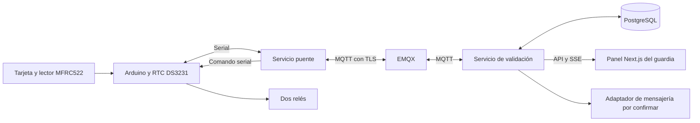

# Sistema IoT de control de acceso con NFC para la asistencia a personas con discapacidad

> Actualización: ya existe una primera implementación y pruebas de software en las carpetas de laboratorio. Ver [IMPLEMENTACION.md](IMPLEMENTACION.md) y [VERIFICACION_IMPLEMENTACION.md](VERIFICACION_IMPLEMENTACION.md). Las matrices siguientes describen la revisión documental anterior y no sustituyen ese registro de avances.

Documento de actualización académica — 20 de octubre de 2026.

## 1. Alcance y criterios de evidencia

El proyecto tiene como propósito identificar mediante una tarjeta a personas que requieren asistencia y avisar al personal de seguridad para facilitar su ingreso. La apertura del acceso constituye una acción de apoyo; no acredita por sí misma que la persona haya ingresado o recibido asistencia.

Esta actualización se elaboró mediante lectura de `C:/Users/HP/Downloads/Informe IOT 1 Unidad.docx`, contraste textual con su PDF y revisión de `Laboratorio_6 - 2026_II.pdf`, `Laboratorio_7.pdf` y `Laboratorio_8__.pdf`. También se leyeron los dos archivos `IOT TRABAJO ACADEMICO*.pdf`, cuyo avance incorpora el enfoque de asistencia a personas con discapacidad y una propuesta de virtualización. Se inspeccionaron los archivos del servidor y frontend. Las extracciones con referencias de página se conservan en `fuentes-extraidas`.

No se encontró un sketch `.ino` en Descargas ni dentro de `rfid-server.zip`; ese ZIP contiene únicamente archivos del servidor web. El texto del informe no contiene el código de comandos Arduino. La revisión del firmware sigue pendiente. Las capturas de las guías ilustran ejercicios del docente, no demuestran ejecución del proyecto. El código presente solo en imágenes no se reutiliza como configuración ejecutable.
Se utilizan tres categorías: **implementado en código**, cuando existe una ruta identificable en los archivos; **reportado sin evidencia**, cuando procede del contexto proporcionado pero no puede verificarse; y **propuesto o pendiente**, cuando requiere desarrollo o comprobación. Implementado en código no equivale a validado en hardware. No se ejecutaron pruebas funcionales ni se generaron resultados experimentales en esta revisión.

## 2. Estado actual y discrepancias

| Elemento | Estado y evidencia | Tratamiento en el informe |
|---|---|---|
| Interfaz Next.js | Implementada en `app/page.js`; dependencia en `package.json` | Conservar Next.js |
| Backend | Node.js/Express visible en `server.js` | Confirmado para esta copia; correspondencia con el equipo desplegado: por confirmar |
| Persistencia | SQLite mediante `sql.js`, exportada a `accesos.db` | PostgreSQL se conserva como tecnología objetivo; migración y despliegue pendientes |
| Arduino, MFRC522, DS3231 y dos relés | Reportados; sin sketch ni inspección física | Modelo de placa, pines, cableado y polaridad: por confirmar |
| Protocolo serial | El servidor recibe `ACCESO,UID,fecha_hora` y escribe `CONCEDIDO,n`, `DENEGADO` o `ABRIR,n` | Evidencia del extremo servidor; firmware por revisar |
| Activación durante 3 segundos | Reportada para los relés | No representa latencia de respuesta; verificar físicamente |
| Permisos temporales | API calcula vencimiento al crear o reemplazar el pase, con hora local del servidor | Es el comportamiento del código disponible; regla académica definitiva por confirmar |
| Duración de 3 horas | Requisito reportado; API acepta otras duraciones y formulario tiene valor inicial de 2 horas | Pendiente fijar 3 horas en la validación del servidor y ajustar interfaz |
| Pantalla y notificación de escritorio | Avisos visuales y `Notification` en `app/page.js` a partir de eventos SSE | Implementados en código; entrega real pendiente de medición |
| Sonido y mensaje externo | Reportados; sin evidencia localizada de reproducción de audio ni proveedor de mensajes | Canal, destinatario, consentimiento de uso y entrega: por confirmar |
| Identificación de necesidad de asistencia | Las tablas actuales no contienen un campo específico de asistencia | Propuesta de modelo; no afirmar selección automática ya implementada |
| MQTT y EMQX | Sin integración localizada en archivos revisados | Propuestos mediante puente serial |
| Resultados cuantitativos | No proporcionados | No declarar eficacia ni tiempos medidos |

Las notificaciones del navegador dependen de permiso, compatibilidad y panel abierto. No equivalen a SMS, correo, WhatsApp u otro servicio externo. El esquema actual asocia UID, nombre, relé y vigencia; no permite inferir una discapacidad a partir de la tarjeta.

## 3. Correspondencia con los laboratorios 6, 7 y 8

El archivo `Laboratorio_6 - 2026_II.pdf` lleva internamente el encabezado «LABORATORIO 05». Se lo identifica como guía recibida como laboratorio 6; confirmar la numeración con el docente.

| Guía y páginas | Requisito o ejercicio | Estado | Evidencia o acción pendiente |
|---|---|---|---|
| 6, pp. 1–4 | Linux, Docker activo y prueba hello-world; SSH como posibilidad | Sin evidencia | Versiones, estado y prueba reales; confirmar obligatoriedad de SSH |
| 6, pp. 4–6 | EMQX, MySQL y phpMyAdmin en Compose | Sin evidencia | Despliegue y aprobación de equivalencia con PostgreSQL |
| 6, p. 6, actividad 1 | Implementar MQTT en el proyecto | Pendiente: código actual serial/SSE | Puente y demostración de publicación/suscripción |
| 6, p. 6, actividad 2 | Componente inteligente menor de 50 palabras | Cumplido documentalmente, sección 9 | Revisión docente |
| 6, p. 6, actividad 3 | Modelos relacional y no relacional | Cumplido como propuesta documental, sección 8 | Confirmar si exige diagrama o implementación adicional |
| 7, p. 1 | Docker y contenedores activos | Sin evidencia | Salida real de docker ps y estado de servicios |
| 7, pp. 2–3 | Dashboard, cambio de contraseña, listeners, WebSocket y suscripción | Sin evidencia | Capturas de la instancia y recepción de mensajes |
| 7, pp. 3–8 | Publicador y suscriptor web separados; ejemplos PHP y monitor EMQX | Pendiente | Demostración con dos clientes; consultar equivalencia con Node.js/Next.js |
| 7, p. 9, actividades 1–2 | MQTT con Arduino y configuraciones necesarias | Pendiente | Puente serial, tópicos, configuración versionada y trazas |
| 8, pp. 1–4 | Entorno Windows virtualizado y acceso remoto a MySQL/administración | Sin evidencia | Acordar entorno equivalente y acceso restringido PostgreSQL |
| 8, pp. 4–5 | Base laboratorio, mqtt_user, mqtt_acl y usuario | Sin evidencia | Tablas independientes de clientes MQTT y consultas compatibles |
| 8, pp. 5–12 | Plugin MySQL, credenciales y SQL de autenticación/ACL | Pendiente de adaptación | Reconstruir con autenticador/autorizador de la versión instalada |
| 8, pp. 9–13 | Ajustar publicador/suscriptor y comprobar entrega | Sin evidencia | Pruebas con credenciales válidas/incorrectas y tópicos permitidos/denegados |

Sin evidencia significa que no se puede demostrar ejecución; pendiente indica desarrollo o adaptación necesario en esta copia. Los preparativos se distinguen de las actividades explícitas de las guías 6 y 7. La guía 8 contiene una secuencia práctica sin lista final de actividades en el texto extraído.

La guía 6 menciona abrir EMQX en navegador por 1883: distinguir el listener MQTT TCP del Dashboard HTTP y verificar puertos en la instancia. No fijar `latest` como versión reproducible: registrar etiqueta exacta y digest de imagen.

## 4. Arquitectura y flujo de operación

### Arquitectura observable

El Arduino se comunica por puerto serial con un servidor Node.js/Express que también atiende la aplicación Next.js. El servidor consulta SQLite, responde al dispositivo, registra el resultado y publica eventos SSE para actualizar el panel. Esta descripción corresponde al repositorio; PostgreSQL forma parte de la arquitectura objetivo.

### Arquitectura objetivo propuesta



1. El lector obtiene el UID. La obtención de fecha y hora desde el DS3231 está reportada; su implementación y sincronización requieren revisar el sketch.
2. Arduino emite una línea `ACCESO,UID,fecha_hora`. En la propuesta, el puente valida formato y longitud, normaliza el UID, conserva la fecha original y agrega identificador del evento y hora de recepción.
3. El servicio de validación consulta la tarjeta, su estado, el permiso asociado al acceso y su vigencia. La necesidad de asistencia se consulta como atributo independiente del permiso. En el código actual únicamente se comprueban UID, estado activo y expiración.
4. Si corresponde autorizar, se genera una orden dirigida al relé 1 o 2. El puente la convierte en `CONCEDIDO,n`; una apertura manual autorizada utiliza `ABRIR,n`. La reacción del firmware a `DENEGADO` está por confirmar.
5. Arduino activa el relé correspondiente durante los 3 segundos reportados. Enviar el comando no demuestra activación eléctrica, apertura mecánica ni tránsito de la persona. Cada una requiere evidencia diferente.
6. Se registra lectura, decisión, motivo, permiso utilizado y estado del envío. Se propone persistir la decisión y la orden pendiente en una transacción antes de enviarla, para permitir trazabilidad. El código actual escribe al serial antes de insertar el registro y carece de confirmación física.
7. Si la persona solicita asistencia, se genera un aviso al guardia con ubicación y acción requerida. La propuesta mantiene el aviso incluso ante una denegación cuando se requiera apoyo, sin abrir automáticamente un acceso no autorizado. El personal confirma recepción y asistencia por separado.

El panel deberá mostrar texto claro y señales visuales; el sonido será complementario. Se propone verificar navegación por teclado, contraste, compatibilidad con lector de pantalla y un procedimiento de asistencia manual ante fallas. No se afirma cumplimiento de una norma de accesibilidad sin evaluación.

## 5. Integración propuesta con MQTT y EMQX

### Verificación de versión

La consulta a las notas oficiales el 20 de octubre de 2026 identificó **EMQX Enterprise 6.3.2**, publicado el 16 de octubre de 2026. Esto verifica una versión publicada, no la instalada en el proyecto. Versión, edición, modalidad de despliegue y licencia disponibles: **por confirmar**. Antes de configurar, registrar la versión mostrada por la instancia y revisar su documentación específica. No se entregan archivos antiguos de plugins ni una configuración ejecutable cuya compatibilidad no pueda verificarse.

Fuente: [Notas oficiales de EMQX Enterprise 6](https://docs.emqx.com/en/emqx/latest/release-notes/changes-ee-v6.html).

La documentación actual describe integración PostgreSQL para autenticación y autorización; deben verificarse disponibilidad y opciones en la edición seleccionada. No basta con sustituir el nombre MySQL en una configuración previa. Fuentes: [Autenticación PostgreSQL](https://docs.emqx.com/en/emqx/latest/guides/access-control/authn/postgresql.html) y [Autorización PostgreSQL](https://docs.emqx.com/en/emqx/latest/guides/access-control/authz/postgresql.html).

### Roles y tópicos propuestos

El puente será el único proceso propietario del puerto serial. El manejador serial actual deberá trasladarse o desactivarse para evitar dos procesos leyendo el mismo puerto o dos decisiones de apertura. El servicio de validación puede reutilizar el backend Node.js/Express observado; su uso definitivo en despliegue está por confirmar.

| Tópico | Publicador | Suscriptor | Finalidad |
|---|---|---|---|
| `asistencia/v1/dispositivos/entrada-01/lecturas` | Puente | Servicio de validación | UID y fecha de lectura |
| `asistencia/v1/dispositivos/entrada-01/comandos` | Servicio de validación | Puente de entrada-01 | Orden de apertura autorizada |
| `asistencia/v1/dispositivos/entrada-01/resultados` | Puente | Servicio de validación | Estado del envío serial, sin atribuir apertura física |
| `asistencia/v1/dispositivos/entrada-01/estado` | Puente | Servicio de supervisión | Conectividad del puente y serial |
| `asistencia/v1/seguridad/avisos` | Servicio de validación | Servicio de notificación | Solicitud de asistencia |
| `asistencia/v1/seguridad/confirmaciones` | Servicio de notificación | Servicio de validación | Recepción confirmada por guardia, cuando exista |

El panel recibe eventos mediante API/SSE del backend; no necesita credenciales del bróker. Si se exige un cliente web MQTT, su implementación y alcance se consultarán con el docente.

Ejemplos ilustrativos; identificadores y tiempos no constituyen resultados de pruebas:

```json
{"schema":1,"event_id":"evt-ejemplo-001","device_id":"entrada-01","uid":"A1B2C3D4","device_time_raw":"2026-10-20 09:00:00","received_at":"2026-10-20T14:00:00Z"}
```

```json
{"command_id":"cmd-ejemplo-001","event_id":"evt-ejemplo-001","action":"CONCEDIDO","relay":1,"issued_at":"2026-10-20T14:00:00Z","expires_at":"2026-10-20T14:00:05Z"}
```

```json
{"command_id":"cmd-ejemplo-001","status":"serial_write_completed","physical_open":null}
```

```json
{"notification_id":"aviso-ejemplo-001","event_id":"evt-ejemplo-001","location":"entrada-01","type":"asistencia_solicitada","message":"Se requiere apoyo en el ingreso","channel":"por_confirmar"}
```

El vencimiento de cinco segundos del ejemplo es una propuesta de vigencia del comando, distinta de la duración del relé y del permiso personal; deberá ajustarse y verificarse mediante pruebas.

Se propone QoS 1 con deduplicación por identificador, comandos sin retención y descarte de órdenes vencidas. Tras una reconexión no deben ejecutarse aperturas atrasadas. Las retransmisiones no deben producir nuevas aperturas. La deduplicación en el puente reduce duplicados MQTT, pero el protocolo serial actual no transporta identificadores ni confirmaciones: no garantiza ejecución exactamente una vez ante un reinicio. Una confirmación del firmware y un identificador serial serían extensiones propuestas, no funciones actuales. La indisponibilidad del servicio debe impedir nuevas aperturas automáticas y activar asistencia manual; no se enviarán comandos de apertura acumulados al recuperar conexión.

### Tres controles independientes

- **Acceso físico:** determina si una persona puede usar un acceso durante un intervalo y qué relé corresponde.
- **Autenticación MQTT:** identifica al puente o servicio que establece conexión; no autentica a la persona portadora de la tarjeta.
- **Autorización MQTT:** limita qué tópicos puede publicar o suscribir cada cliente. El puente solo publica lecturas/resultados/estado de su dispositivo y se suscribe a sus comandos; el validador tiene permisos inversos y publica avisos. El notificador no publica comandos de apertura.

Se propone TLS con validación del certificado, credenciales independientes por servicio y denegación de operaciones no autorizadas. Las credenciales del guardia para administrar el panel constituyen otro control de aplicación; la API local disponible no muestra autenticación. No exponerla como panel remoto de producción sin implementar ese control. El UID identifica una tarjeta; no debe describirse como prueba criptográfica de identidad ni de discapacidad.

## 6. Conservación de Next.js y PostgreSQL; adaptación desde MySQL

Next.js se mantiene como interfaz. PostgreSQL se mantiene como base objetivo sin presentar la copia SQLite actual como PostgreSQL. Se propone sustituir la capa `sql.js` por un controlador PostgreSQL, parametrizar consultas, migrar datos con respaldo y verificar transacciones y fechas. Este documento no realiza esa migración.

| Ejercicio o construcción MySQL | Adaptación PostgreSQL propuesta |
|---|---|
| `AUTO_INCREMENT` | `GENERATED ALWAYS AS IDENTITY` |
| Identificadores entre backticks | Nombres sin comillas o comillas dobles cuando sea necesario |
| `TINYINT(1)` para estado | `BOOLEAN` |
| `DATETIME` y `DATE_ADD(... INTERVAL 3 HOUR)` | `TIMESTAMPTZ` y `inicio + INTERVAL '3 hours'` |
| Marcadores `?` | Parámetros `$1`, `$2`, según el controlador |
| `ON DUPLICATE KEY UPDATE` | `ON CONFLICT ... DO UPDATE`, con restricción única explícita |
| Usuarios y privilegios MySQL | Roles y privilegios PostgreSQL con alcance equivalente |

La guía 8 cita EMQX 4.3 (p. 4) y utiliza plugins de esa generación. No copiar esa configuración en la versión actual: reconstruir autenticación y autorización según la instancia elegida. El usuario del Dashboard es distinto de un cliente MQTT y de un permiso físico.

phpMyAdmin no administra PostgreSQL; se propone pgAdmin o psql como equivalente, previa aceptación docente. No trasladar literalmente el acceso general de Apache ni `bind-address=0.0.0.0`: definir conectividad restringida, `listen_addresses` y `pg_hba.conf` según versión y despliegue. La secuencia se adapta para demostrar conectividad y permisos.

La copia actual también requiere sustituir `INSERT OR REPLACE`, `datetime('now','localtime',...)` y la exportación del archivo SQLite. La regla propuesta es almacenar instantes con zona horaria, evaluar vigencias en el servidor y presentar fechas en `America/Lima`. No utilizar la hora no verificada del RTC como única autoridad para permisos.

Debe consultarse al docente si el laboratorio admite PostgreSQL en lugar de MySQL, si exige un conector EMQX específico, una versión determinada, capturas o comandos del motor original, y si la alternativa no relacional requiere solo diseño o implementación. La equivalencia conceptual no prueba cumplimiento formal de la rúbrica.

Para permisos de tres horas se propone `valido_hasta = valido_desde + INTERVAL '3 hours'` y validez en el intervalo semiabierto `[valido_desde, valido_hasta)`. Inicio desde emisión, aprobación o primer uso: **por confirmar**. Si se adopta emisión, coincide conceptualmente con el código disponible; primer uso exigiría registrar ese instante de manera atómica. Renovar no debe borrar la historia del permiso anterior.

## 7. Revisión Arduino: alcance y acciones pendientes

No se dispone del sketch, por lo que no es posible identificar nombres de constantes ni números de pines sin definir, verificar compilación o asegurar que exista `delay(3000)`. Estos puntos quedan como revisión pendiente, no como defectos demostrados.

| Punto | Revisión necesaria |
|---|---|
| Pines de los dos relés | Identificar las declaraciones ausentes o incompletas en el sketch. No asignar números hasta conocer placa y cableado; revisar compatibilidad con conexiones SPI del lector e I2C del RTC |
| Polaridad y arranque | Confirmar nivel activo y asegurar ambos relés inactivos al iniciar; no asumir relé activo en HIGH o LOW |
| Comandos | Aceptar exclusivamente `CONCEDIDO,1`, `CONCEDIDO,2`, `ABRIR,1` y `ABRIR,2`, con terminador definido; rechazar campos extra, relé fuera de rango y líneas incompletas |
| Conversión numérica | Evitar una conversión permisiva que acepte `1basura` como 1; comprobar token completo y cantidad de campos |
| Recepción serial | Limitar longitud del búfer, manejar CR/LF, fragmentación y tiempo máximo de línea sin bloquear indefinidamente |
| Denegación | Definir manejo de `DENEGADO` sin activación y sin confundirlo con un comando de apertura |
| Bloqueos | Si existe `delay(3000)`, durante ese intervalo el flujo principal no procesa nuevas lecturas ni comandos; las interrupciones pueden seguir recibiendo bytes y el búfer podría desbordarse |
| Temporización propuesta | Usar máquina de estados y `millis()` por relé; definir qué ocurre con órdenes simultáneas o repetidas y comparar tiempos mediante resta sin signo |

La activación de tres segundos no informa cuánto tarda el sistema desde leer la tarjeta hasta comenzar la apertura. Eliminar `delay()` es una propuesta de mejora condicionada a revisar el firmware real.

## 8. Modelo de datos propuesto

### Modelo relacional para PostgreSQL

| Entidad | Campos principales y restricciones |
|---|---|
| persona | `persona_id` PK, nombre, `requiere_asistencia` booleano, instrucciones de apoyo opcionales y mínimas |
| tarjeta | `tarjeta_id` PK, `persona_id` FK, UID único, activa |
| dispositivo | `dispositivo_id` PK, ubicación, estado de habilitación |
| acceso_fisico | `acceso_id` PK, `dispositivo_id` FK, relé con CHECK en (1,2), UNIQUE(dispositivo_id, relé) |
| permiso | `permiso_id` PK, `tarjeta_id` FK, `acceso_id` FK, tipo, `valido_desde`, `valido_hasta` nullable para permanente, revocado_en; CHECK(hasta > desde) cuando no sea nulo |
| evento_acceso | `evento_id` UUID PK para deduplicación, `tarjeta_id` FK nullable, UID observado, `dispositivo_id` FK, `permiso_id` FK nullable, hora RTC original, recepción del servidor, decisión y motivo |
| comando | `comando_id` PK, `evento_id` FK nullable para apertura manual, `acceso_id` FK, origen, operador opcional, emitido_en, vence_en, estado de envío, confirmado_en nullable |
| notificacion | `notificacion_id` PK, `evento_id` FK, tipo, canal, estado, creada_en, entregada_en nullable, confirmada_en nullable |
| intento_notificacion | `intento_id` PK, `notificacion_id` FK, instante, proveedor, estado y referencia externa opcional |

Relaciones: persona 1:N tarjeta; tarjeta 1:N permiso; acceso_fisico 1:N permiso; dispositivo 1:N acceso_fisico y evento_acceso; evento_acceso 1:N comando y notificacion; notificacion 1:N intento_notificacion. La tarjeta nullable permite registrar UID desconocido. El evento conserva la decisión histórica aunque posteriormente cambie el permiso.

Se proponen índices en UID, permisos por tarjeta/acceso/vigencia y eventos por fecha. La duración fija de permisos temporales debe validarse en la operación que los crea. Datos y permisos de clientes MQTT se almacenarán por separado, por ejemplo en un esquema `mqtt_security`, con credenciales protegidas y ACL de tópicos independientes. Los roles del panel también son distintos de los permisos físicos.

No es necesario almacenar diagnósticos clínicos: registrar únicamente la asistencia solicitada y restringir el acceso del personal a los datos necesarios. Plazo de conservación, responsables y condiciones de tratamiento: por confirmar.

### Alternativa no relacional académica

Se propone, como alternativa de diseño, una base documental con colecciones `personas`, `tarjetas`, `permisos`, `eventos` y `notificaciones`. Los permisos se mantienen separados de eventos para evitar crecimiento ilimitado de arreglos y permitir renovaciones trazables. Un evento puede incorporar una instantánea mínima de la decisión y del apoyo solicitado.

```json
{"_id":"evt-ejemplo-001","tarjeta_id":"tarjeta-ejemplo","dispositivo_id":"entrada-01","recibido_en":"2026-10-20T14:00:00Z","decision":"CONCEDIDO","permiso_id":"permiso-ejemplo","asistencia":{"solicitada":true},"comando":{"id":"cmd-ejemplo-001","estado":"pendiente"}}
```

Se requieren índices únicos de UID e identificador de evento, validación de documentos y control de consistencia al consultar permisos. El vencimiento se evalúa en cada solicitud; un mecanismo TTL de borrado no debe decidir la autorización. La alternativa documental permite comparar flexibilidad y consistencia con el modelo relacional. No se propone operar dos bases simultáneamente salvo exigencia expresa de la actividad.

## 9. Componente inteligente: automatización basada en reglas

El sistema aplica reglas para validar tarjetas y permisos vigentes, seleccionar el relé autorizado y generar avisos cuando una persona solicita asistencia. Registra las decisiones y señala incidencias al personal de seguridad. Esta automatización no utiliza inteligencia artificial ni modelos de aprendizaje automático.

## 10. Plan de pruebas y resultados pendientes

Antes de ensayar, registrar versión de firmware, placa, pines verificados, versión del servidor y bróker, esquema de base, topología, sincronización de relojes y regla de inicio del permiso. Definir previamente cantidad de intentos y umbrales de aceptación con el docente; ambos están por confirmar. Utilizar identificadores de prueba sin diagnósticos ni datos personales innecesarios.

| Prueba | Procedimiento | Medida |
|---|---|---|
| Lectura correcta | Presentar tarjetas con UID conocido, registrando cada presentación independientemente del sistema; variar orientación y distancia documentadas | Lecturas con UID correcto / presentaciones; registrar no lecturas, UID incorrectos y duplicados por separado |
| Validación y errores | Probar tarjeta activa, desconocida, revocada, vencida, UID mal formado y relé inválido | Comparar decisión esperada y obtenida; falsos permisos y falsas denegaciones por separado |
| Latencia de apertura | Capturar instante de UID disponible y comienzo de activación del relé con instrumentación común; medir apertura mecánica por separado si existe sensor | Diferencia por intento, luego mediana, percentil 95 y máximo; método y resolución documentados |
| Pulso del relé | Medir inicio y fin eléctricos de cada relé con instrumento apropiado | Duración real del pulso frente a 3 s nominales y tolerancia por acordar |
| Aviso visual y sonoro | Provocar solicitud de asistencia y observar pantalla; comprobar sonido solo cuando exista implementación | Avisos generados, mostrados y audibles por separado; tiempos desde lectura y desde generación |
| Mensajería | Elegir canal, provocar aviso y registrar identificador del proveedor; comprobar recepción en el destino | Aceptación del proveedor, entrega y confirmación del guardia como estados diferentes |
| Permiso temporal | Con inicio definido, comprobar antes, exactamente en y después del vencimiento de 3 horas; incluir revocación y renovación | Resultado esperado/obtenido y marcas temporales del servidor; a la igualdad se propone denegar |
| Fallas y reconexión | Desconectar serial, red, bróker y base; reinyectar mensajes duplicados y comandos vencidos | Órdenes indebidas, pérdidas, duplicados y recuperación; ninguna apertura por comando vencido |
| Asistencia y accesibilidad | Recorrer panel con teclado y lector de pantalla; simular recepción y confirmación del guardia | Barreras observadas y trazabilidad de asistencia; evaluación con personas usuarias, si se realiza, requiere planificación y participantes por confirmar |

La disponibilidad del UID es el inicio técnico definido para la medición; si se mide desde la presentación física, se informará como otra métrica. Un RTC con resolución de segundos no basta para estimar latencias pequeñas. No restar relojes de equipos distintos sin controlar desfase. El retorno de escritura serial y el acuse MQTT no son mediciones de apertura. Para percentiles, informar número de observaciones y método de cálculo.

La prueba de tres horas debe ejecutarse con duración real; las pruebas con reloj controlado son complementarias y se reportan como simuladas. El criterio propuesto para notificaciones es comparar recibidas en destino con generadas, conservando fallas y reintentos; entrega no demuestra asistencia efectiva.

### Tabla vacía de resultados reales

| ID | Caso / condición | Versión / configuración | Intentos | Lecturas correctas | No lecturas / errores / duplicados | Decisión esperada / obtenida | t lectura | t inicio relé | Latencia ms | Pulso ms | Canal | t entrega | Confirmación guardia | Inicio / vencimiento permiso | Evidencia / observaciones |
|---|---|---|---|---|---|---|---|---|---|---|---|---|---|---|---|
| | | | | | | | | | | | | | | | |
| | | | | | | | | | | | | | | | |
| | | | | | | | | | | | | | | | |

No existen resultados cuantitativos incorporados. La ejecución de pruebas y la evaluación del sistema completo permanecen pendientes.

## 11. Evidencias pendientes

1. Aprobación docente de equivalencias PostgreSQL/Next.js/EMQX actual y aclaración de numeración de guía 6.
2. Sketch Arduino, modelo de placa, diagrama de cableado, pines y polaridad de ambos relés.
3. Confirmación del entorno desplegado y evidencia de migración a PostgreSQL.
4. Regla del inicio de las tres horas y cambio de la duración configurable actual.
5. Versión/edición de EMQX, configuración compatible, ACL y capturas de publicaciones y suscripciones.
6. Canal de mensajes, sonido y mecanismo específico de identificación de asistencia; evidencia de entrega y confirmación.
7. Mediciones reales con registros, instrumentos y condiciones de ensayo; sin sustituirlas por pruebas de interfaz o capturas existentes.
