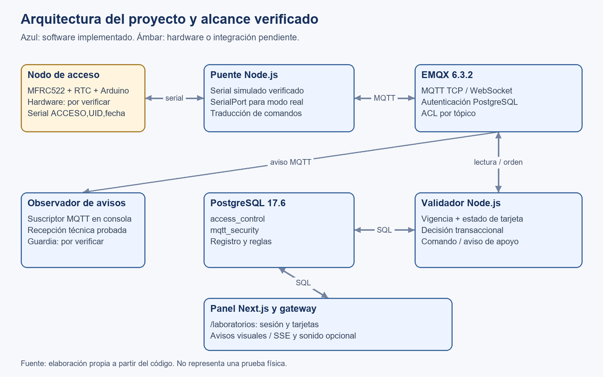
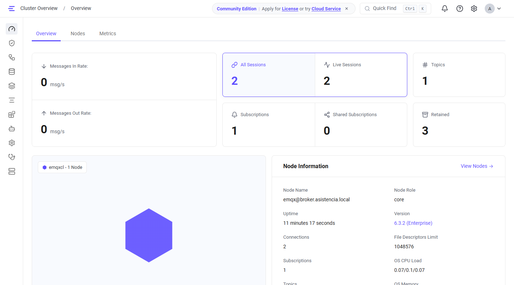
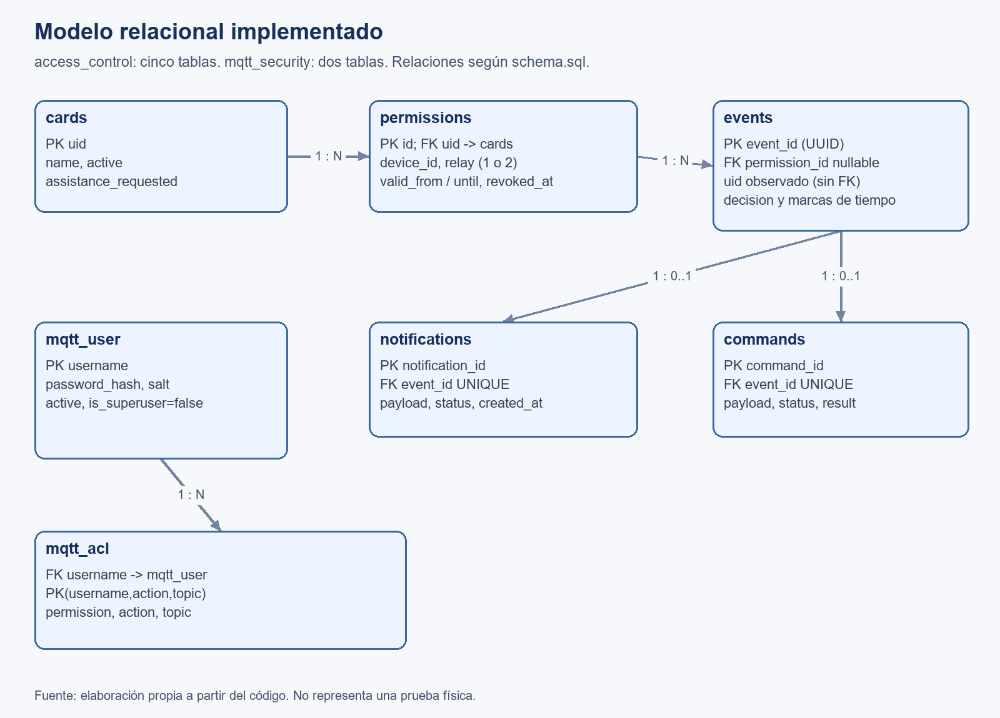

# Laboratorio 6

Actualización de navegación y avisos: la asistencia es ahora la pantalla principal de `npm run dev` (puerto 3000). El control de acceso se conserva como sección secundaria. Los enlaces `wa.me` permiten demostrar el aviso con envío manual; la apertura del chat no confirma entrega ni asistencia. Consultar [WHATSAPP.md](../WHATSAPP.md).

Actualización del 27/10/2026: el flujo de asistencia del informe corregido ya dispone de estados separados, responsable, historial, reglas auditadas y canal sin tarjeta. La [matriz de correspondencia](../CORRESPONDENCIA_INFORME.md) describe la implementación actual y lo pendiente de hardware y campo. Las descripciones y evidencias fechadas el 24/10/2026 que siguen representan el avance de esa fecha.

Infraestructura IoT con Docker, MQTT y modelos de datos

## 1. Identificación y alcance

Proyecto: Sistema IoT de control de acceso con NFC para la asistencia a personas con discapacidad. Institución académica: Universidad Nacional de Trujillo, Facultad de Ingeniería, Escuela Profesional de Ingeniería de Sistemas. Curso: Internet de las Cosas. Docente: Dr. Ing. Gómez Avila José. Fecha de elaboración: 24 de octubre de 2026.

Se presenta el desarrollo aplicado al proyecto, con código fuente, procedimientos reproducibles y evidencias de software. La validación utiliza EMQX y PostgreSQL reales, y un extremo serial simulado. No participaron personas en estos ensayos ni se conectaron lector, RTC o relés para comprobarlos. Los resultados no demuestran apertura mecánica ni asistencia efectiva a un usuario.

Se diferencia entre implementado y comprobado en software, reportado sin comprobación física, y propuesto. La ruta /laboratorios de Next.js está conectada a los servicios PostgreSQL/MQTT mediante un gateway local autenticado. La aplicación original conserva su ruta y SQLite; no se migraron sus datos. El desarrollo se limita a laboratorios 6 y 7. El laboratorio 8 queda a cargo de otro integrante y sus archivos no se modifican.

## 2. Objetivos y correspondencia con la guía

Implementar un entorno reproducible de servicios IoT, integrar MQTT al flujo de control de acceso, describir la automatización inteligente y presentar los modelos relacional y no relacional asociados al proyecto.

El archivo recibido como Laboratorio_6 - 2026_II.pdf contiene el encabezado interno LABORATORIO 05. Se conserva la denominación del archivo recibido y se señala la discrepancia para aclaración docente. Las páginas 1–5 desarrollan la preparación de Linux, Docker y un stack EMQX/MySQL/phpMyAdmin; la página 6 solicita las tres actividades académicas.

| Requisito | Desarrollo realizado | Alcance |
|---|---|---|
| Linux y Docker | Docker Desktop con motor Linux y contenedores activos | Equivalencia técnica; no es una instalación nativa de Ubuntu |
| Servicios MQTT y base de datos | EMQX 6.3.2 y PostgreSQL 17.6 | Implementados y comprobados |
| MQTT en el proyecto | Puente serial–MQTT y validador | Serial simulado; hardware por verificar |
| Componente inteligente menor de 50 palabras | Texto de la sección 7 | Cumplido documentalmente |
| Modelos relacional y no relacional | Esquema implementado y alternativa documental | No exige operar ambas bases simultáneamente |

## 3. Fundamento técnico

Docker permite ejecutar servicios aislados con redes y volúmenes propios. MQTT desacopla la captura de lecturas, la validación y la observación de avisos mediante publicación y suscripción. EMQX distribuye los mensajes; el servicio de validación decide el permiso físico consultando PostgreSQL. El bróker no decide si una persona puede ingresar.

La configuración fija las imágenes por versión y digest, evitando que latest modifique silenciosamente el entorno. El Dashboard HTTP usa el puerto local 18083, MQTT TCP el 1883 y MQTT sobre WebSocket el 8083. El puerto 1883 no se utiliza como una página web de administración.

## 4. Materiales y arquitectura implementada

| Elemento | Uso |
|---|---|
| Windows anfitrión y Docker Desktop | Ejecución de contenedores Linux |
| Node.js y bibliotecas mqtt, pg y serialport | Puente, decisiones y persistencia |
| EMQX Enterprise 6.3.2, licencia Community de nodo único | Distribución y control de clientes MQTT |
| PostgreSQL 17.6 | Datos de acceso y seguridad MQTT en esquemas separados |
| Next.js | Vista /laboratorios conectada al gateway PostgreSQL/MQTT |
| Arduino, MFRC522, DS3231 y dos relés | Componentes reportados; comprobación física pendiente |

La Figura 1 diferencia lo implementado en software de las integraciones pendientes. El canal entre puente y EMQX es MQTT TCP local sin TLS en este ensayo, restringido al equipo; TLS se requiere al extenderlo a otros equipos.



Flujo desarrollado: lectura serial simulada → publicación MQTT → consulta de estado y permiso → registro transaccional → orden MQTT al puente → representación del comando serial. Cuando el perfil solicita asistencia se publica un aviso; el observador de consola permite comprobar recepción técnica. Los tres segundos corresponden a la duración nominal reportada del relé, no a la latencia del flujo.

El archivo infra/schema.sql es una instantánea del contrato de datos ya existente, usada como prerrequisito de los laboratorios 6 y 7. La configuración de infraestructura ya no carga archivos desde la carpeta laboratorio-8. La evolución del laboratorio 8 queda a cargo del integrante responsable.

## 5. Procedimiento reproducible

Todos los comandos se ejecutan desde la raíz del repositorio. En una copia nueva, instalar dependencias y generar la configuración local una sola vez:

```powershell
npm install
npm run iot:setup
npm run iot:up
```

setup.cjs genera contraseñas aleatorias y los archivos .env.local, emqx.generated.conf y bootstrap.generated.sql. Se niega a sobrescribir archivos existentes. No se publican esos archivos con secretos en el paquete de entrega: se regeneran en el equipo de evaluación. Las variables de PostgreSQL, cookie de EMQX y contraseña del Dashboard se toman de ese archivo local.

compose.yaml crea una red de laboratorio y volúmenes persistentes. PostgreSQL inicializa schema.sql y los roles; EMQX se inicia después de que la base esté saludable. El montaje usa base.hocon, conservando el archivo base de sistema emqx.conf. No se copian plugins de EMQX 4.3.

```powershell
docker version
docker info
docker run --rm hello-world
docker ps
npm run iot:verify
```

La consulta de versiones y hello-world se ejecutaron realmente; sus salidas están en evidencias/verificacion-software.json. El Dashboard también se comprobó mediante navegador y captura autenticada, sin mostrar contraseñas.



Para detener los servicios conservando los datos:

```powershell
npm run iot:down
```

## 6. Modelo relacional y alternativa no relacional

El modelo relacional de la Figura 3 corresponde a schema.sql, no a tablas supuestas. La tabla cards agrupa nombre, estado y solicitud de asistencia en esta implementación inicial. Una futura normalización en persona y tarjeta sería una ampliación, no una tabla ya implementada.



| Tabla | Clave y propósito |
|---|---|
| access_control.cards | PK uid; persona de prueba, estado y solicitud de asistencia |
| access_control.permissions | PK id, FK uid; dispositivo, relé, inicio, fin y revocación |
| access_control.events | PK UUID; UID observado, permiso opcional y decisión histórica |
| access_control.commands | PK command_id, event_id único; payload y estado del envío |
| access_control.notifications | PK notification_id, event_id único; aviso y estado |
| mqtt_security.mqtt_user | PK username; hash, salt y estado de cliente de servicio |
| mqtt_security.mqtt_acl | PK compuesta username/action/topic; autorización MQTT |

Las relaciones cards–permissions y permissions–events son 1:N. Cada evento puede tener como máximo un comando y un aviso en este esquema. El UID observado en events no es FK a cards para permitir registrar tarjetas desconocidas. mqtt_acl referencia a mqtt_user. La solicitud de asistencia es independiente del permiso de ingreso.

Se usan TIMESTAMPTZ, claves foráneas, relé restringido a 1 o 2 y un CHECK que exige tres horas para permisos temporales; los permanentes admiten fin nulo. El intervalo autorizado es [valid_from, valid_until). El inicio se suministra explícitamente para cada ensayo; su regla institucional sigue por confirmar.

Como alternativa académica no relacional se presenta modelo-no-relacional.json, con colecciones tarjetas, permisos, eventos y notificaciones. Las referencias se expresan mediante identificadores; el evento conserva una instantánea mínima de la decisión. Se proponen índices únicos para UID e identificador del evento, y búsquedas por tarjeta/dispositivo/vigencia. La aplicación debe comprobar integridad y vigencia; un borrado TTL no sustituye la validación de permisos.

| Criterio | Modelo relacional elegido | Alternativa documental |
|---|---|---|
| Consistencia | Transacciones y restricciones del motor | Validaciones e integridad gestionadas según el motor |
| Historial | Eventos y permisos separados | Documentos separados y referencias |
| Flexibilidad | Cambios mediante migraciones | Campos extensibles con esquema validado |
| Estado en el proyecto | Implementado en PostgreSQL | Diseño académico, no desplegado |

## 7. Componente inteligente: 43 palabras

El sistema aplica reglas para validar tarjetas y permisos vigentes, seleccionar el relé autorizado y generar avisos cuando una persona solicita asistencia. Registra las decisiones y señala incidencias al personal de seguridad. Esta automatización no utiliza inteligencia artificial ni modelos de aprendizaje automático.

## 8. Resultados observados

| ID | Comprobación ejecutada | Resultado |
|---|---|---|
| L6-01 | Docker y motor Linux | APROBADO |
| L6-02 | Contenedor hello-world | APROBADO |
| L6-03 | Servicios y versión EMQX | APROBADO |
| L6-04 | PostgreSQL y esquema aplicado | APROBADO |
| L6-05 | Validación del protocolo sin hardware | APROBADO |

Los resultados corresponden a esta ejecución identificada en los archivos de evidencia. El ensayo hello-world confirma capacidad de ejecutar contenedores y la consulta SQL confirma siete tablas en los dos esquemas. La validación del protocolo verifica formatos, fragmentación serial y rechazo de órdenes fuera de vigencia; no mide rendimiento físico.

## 9. Discusión, adaptación y conclusiones

Se obtuvo un entorno funcional de MQTT y PostgreSQL y se integró el flujo con un extremo serial simulado. El diseño separa acceso físico, autenticación del cliente MQTT y autorización por tópico. La automatización responde a reglas y conserva el enfoque de asistencia sin almacenar diagnósticos clínicos.

Se conserva PostgreSQL en lugar de MySQL; psql sustituye la administración utilizada en el ensayo, sin instalar phpMyAdmin. Docker sobre Windows proporciona el motor Linux, pero no demuestra instalación nativa de Ubuntu, SSH remoto ni una máquina Windows invitada. La aceptación formal de estas equivalencias y la discrepancia de numeración deben consultarse al docente.

La actividad documental queda desarrollada y los servicios están verificados en software. Falta la evidencia física de Arduino, la entrega humana efectiva de asistencia y la medición real de permisos durante tres horas. El panel web ya está integrado y su prueba se documenta en el laboratorio 7. Estos puntos no se presentan como aprobados.

## 10. Anexos y evidencias

- compose.yaml y setup.cjs: infraestructura y generación de configuración.
- infra/schema.sql: DDL relacional ejecutado.
- modelo-no-relacional.json: alternativa documental ilustrativa.
- evidencias/verificacion-software.json: salidas y versión del ensayo.
- resultados_software.csv: resultados reales; resultados_pruebas.csv conserva plantilla para mediciones futuras.

## Referencias

- Guía original del laboratorio, incluida en GUIA_ORIGINAL.pdf. Las páginas citadas corresponden a ese archivo.
- Informe IOT 1 Unidad.docx, proporcionado por el equipo; utilizado para conservar el contexto del proyecto.
- EMQX. Instalación con Docker: https://docs.emqx.com/en/emqx/latest/get-started/deploy/install-docker.html
- EMQX. Configuración y precedencia: https://docs.emqx.com/en/emqx/latest/guides/configuration/configuration.html
- EMQX. Autenticación PostgreSQL: https://docs.emqx.com/en/emqx/latest/guides/access-control/authn/postgresql.html
- EMQX. Autorización PostgreSQL: https://docs.emqx.com/en/emqx/latest/guides/access-control/authz/postgresql.html

La referencia a documentación actual sustenta la configuración utilizada; no se afirma que 6.3.2 sea la última versión disponible. La versión ejecutada se verifica en los registros y el Dashboard.

