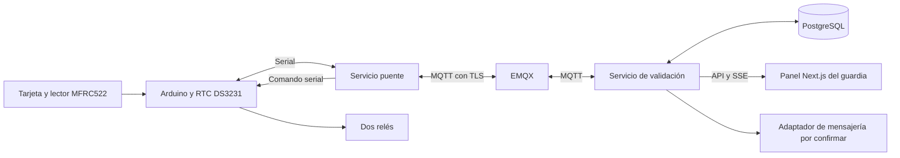

# Laboratorio 6 — Infraestructura IoT, MQTT y modelos de datos

> Este desarrollo recoge la revisión previa. Para el código implementado y las comprobaciones posteriores, consultar [IMPLEMENTACION.md](../IMPLEMENTACION.md) y [VERIFICACION_IMPLEMENTACION.md](../VERIFICACION_IMPLEMENTACION.md).

La guía recibida como laboratorio 6 lleva el encabezado interno “LABORATORIO 05”; numeración por confirmar con el docente.

## Alcance y estado de la entrega

Desarrollo documental aplicado al “Sistema IoT de control de acceso con NFC para la asistencia a personas con discapacidad”. No se ejecutaron instalaciones ni pruebas de hardware para esta entrega. Se distingue la implementación visible en código de las propuestas y de los requisitos sin evidencia. Se conserva Next.js y PostgreSQL como objetivo; esta copia del servidor utiliza Node.js/Express y SQLite. El sketch Arduino sigue sin localizarse.

## Objetivo y requisitos de la guía

Experimentar con un servidor Linux, Docker y servicios MQTT/base de datos. Las actividades de la página 6 solicitan implementar MQTT en el proyecto, describir el componente inteligente en menos de 50 palabras y presentar modelos relacional y no relacional.

## Desarrollo aplicado al proyecto

1. Preparar el entorno Linux y documentar versión, conectividad y, si se utiliza, SSH.
2. Comprobar instalación de Docker, servicio activo y ejecución de hello-world. Resultados: por confirmar.
3. Preparar un despliegue reproducible de EMQX y PostgreSQL, con versiones explícitas y persistencia. Consultar sustitución de MySQL/phpMyAdmin por PostgreSQL y pgAdmin/psql.
4. Incorporar el puente serial–MQTT descrito a continuación. Es una propuesta de integración, no una función del firmware actual.
5. Presentar ambos modelos como alternativas académicas. No se exige implementar dos bases simultáneamente sin confirmación docente.

## 4. Arquitectura y flujo de operación

### Arquitectura observable

El Arduino se comunica por puerto serial con un servidor Node.js/Express que también atiende la aplicación Next.js. El servidor consulta SQLite, responde al dispositivo, registra el resultado y publica eventos SSE para actualizar el panel. Esta descripción corresponde al repositorio; PostgreSQL forma parte de la arquitectura objetivo.

### Arquitectura objetivo propuesta



1. El lector obtiene el UID. La obtención de fecha y hora desde el DS3231 está reportada; su implementación y sincronización requieren revisar el sketch.
2. Arduino emite una línea `ACCESO,UID,fecha_hora`. En la propuesta, el puente valida formato y longitud, normaliza el UID, conserva la fecha original y agrega identificador del evento y hora de recepción.
3. El servicio de validación consulta la tarjeta, su estado, el permiso asociado al acceso y su vigencia. La necesidad de asistencia se consulta como atributo independiente del permiso. En el código actual únicamente se comprueban UID, estado activo y expiración.
4. Si corresponde autorizar, se genera una orden dirigida al relé 1 o 2. El puente la convierte en `CONCEDIDO,n`; una apertura manual autorizada utiliza `ABRIR,n`. La reacción del firmware a `DENEGADO` está por confirmar.
5. Arduino activa el relé correspondiente durante los 3 segundos reportados. Enviar el comando no demuestra activación eléctrica, apertura mecánica ni tránsito de la persona. Cada una requiere evidencia diferente.
6. Se registra lectura, decisión, motivo, permiso utilizado y estado del envío. Se propone persistir la decisión y la orden pendiente en una transacción antes de enviarla, para permitir trazabilidad. El código actual escribe al serial antes de insertar el registro y carece de confirmación física.
7. Si la persona solicita asistencia, se genera un aviso al guardia con ubicación y acción requerida. La propuesta mantiene el aviso incluso ante una denegación cuando se requiera apoyo, sin abrir automáticamente un acceso no autorizado. El personal confirma recepción y asistencia por separado.

El panel deberá mostrar texto claro y señales visuales; el sonido será complementario. Se propone verificar navegación por teclado, contraste, compatibilidad con lector de pantalla y un procedimiento de asistencia manual ante fallas. No se afirma cumplimiento de una norma de accesibilidad sin evaluación.

## 5. Integración propuesta con MQTT y EMQX

### Verificación de versión

La consulta a las notas oficiales el 20 de octubre de 2026 identificó **EMQX Enterprise 6.3.2**, publicado el 16 de octubre de 2026. Esto verifica una versión publicada, no la instalada en el proyecto. Versión, edición, modalidad de despliegue y licencia disponibles: **por confirmar**. Antes de configurar, registrar la versión mostrada por la instancia y revisar su documentación específica. No se entregan archivos antiguos de plugins ni una configuración ejecutable cuya compatibilidad no pueda verificarse.

Fuente: [Notas oficiales de EMQX Enterprise 6](https://docs.emqx.com/en/emqx/latest/release-notes/changes-ee-v6.html).

La documentación actual describe integración PostgreSQL para autenticación y autorización; deben verificarse disponibilidad y opciones en la edición seleccionada. No basta con sustituir el nombre MySQL en una configuración previa. Fuentes: [Autenticación PostgreSQL](https://docs.emqx.com/en/emqx/latest/guides/access-control/authn/postgresql.html) y [Autorización PostgreSQL](https://docs.emqx.com/en/emqx/latest/guides/access-control/authz/postgresql.html).

### Roles y tópicos propuestos

El puente será el único proceso propietario del puerto serial. El manejador serial actual deberá trasladarse o desactivarse para evitar dos procesos leyendo el mismo puerto o dos decisiones de apertura. El servicio de validación puede reutilizar el backend Node.js/Express observado; su uso definitivo en despliegue está por confirmar.

| Tópico | Publicador | Suscriptor | Finalidad |
|---|---|---|---|
| `asistencia/v1/dispositivos/entrada-01/lecturas` | Puente | Servicio de validación | UID y fecha de lectura |
| `asistencia/v1/dispositivos/entrada-01/comandos` | Servicio de validación | Puente de entrada-01 | Orden de apertura autorizada |
| `asistencia/v1/dispositivos/entrada-01/resultados` | Puente | Servicio de validación | Estado del envío serial, sin atribuir apertura física |
| `asistencia/v1/dispositivos/entrada-01/estado` | Puente | Servicio de supervisión | Conectividad del puente y serial |
| `asistencia/v1/seguridad/avisos` | Servicio de validación | Servicio de notificación | Solicitud de asistencia |
| `asistencia/v1/seguridad/confirmaciones` | Servicio de notificación | Servicio de validación | Recepción confirmada por guardia, cuando exista |

El panel recibe eventos mediante API/SSE del backend; no necesita credenciales del bróker. Si se exige un cliente web MQTT, su implementación y alcance se consultarán con el docente.

Ejemplos ilustrativos; identificadores y tiempos no constituyen resultados de pruebas:

```json
{"schema":1,"event_id":"evt-ejemplo-001","device_id":"entrada-01","uid":"A1B2C3D4","device_time_raw":"2026-10-20 09:00:00","received_at":"2026-10-20T14:00:00Z"}
```

```json
{"command_id":"cmd-ejemplo-001","event_id":"evt-ejemplo-001","action":"CONCEDIDO","relay":1,"issued_at":"2026-10-20T14:00:00Z","expires_at":"2026-10-20T14:00:05Z"}
```

```json
{"command_id":"cmd-ejemplo-001","status":"serial_write_completed","physical_open":null}
```

```json
{"notification_id":"aviso-ejemplo-001","event_id":"evt-ejemplo-001","location":"entrada-01","type":"asistencia_solicitada","message":"Se requiere apoyo en el ingreso","channel":"por_confirmar"}
```

El vencimiento de cinco segundos del ejemplo es una propuesta de vigencia del comando, distinta de la duración del relé y del permiso personal; deberá ajustarse y verificarse mediante pruebas.

Se propone QoS 1 con deduplicación por identificador, comandos sin retención y descarte de órdenes vencidas. Tras una reconexión no deben ejecutarse aperturas atrasadas. Las retransmisiones no deben producir nuevas aperturas. La deduplicación en el puente reduce duplicados MQTT, pero el protocolo serial actual no transporta identificadores ni confirmaciones: no garantiza ejecución exactamente una vez ante un reinicio. Una confirmación del firmware y un identificador serial serían extensiones propuestas, no funciones actuales. La indisponibilidad del servicio debe impedir nuevas aperturas automáticas y activar asistencia manual; no se enviarán comandos de apertura acumulados al recuperar conexión.

### Tres controles independientes

- **Acceso físico:** determina si una persona puede usar un acceso durante un intervalo y qué relé corresponde.
- **Autenticación MQTT:** identifica al puente o servicio que establece conexión; no autentica a la persona portadora de la tarjeta.
- **Autorización MQTT:** limita qué tópicos puede publicar o suscribir cada cliente. El puente solo publica lecturas/resultados/estado de su dispositivo y se suscribe a sus comandos; el validador tiene permisos inversos y publica avisos. El notificador no publica comandos de apertura.

Se propone TLS con validación del certificado, credenciales independientes por servicio y denegación de operaciones no autorizadas. Las credenciales del guardia para administrar el panel constituyen otro control de aplicación; la API local disponible no muestra autenticación. No exponerla como panel remoto de producción sin implementar ese control. El UID identifica una tarjeta; no debe describirse como prueba criptográfica de identidad ni de discapacidad.

## 8. Modelo de datos propuesto

### Modelo relacional para PostgreSQL

| Entidad | Campos principales y restricciones |
|---|---|
| persona | `persona_id` PK, nombre, `requiere_asistencia` booleano, instrucciones de apoyo opcionales y mínimas |
| tarjeta | `tarjeta_id` PK, `persona_id` FK, UID único, activa |
| dispositivo | `dispositivo_id` PK, ubicación, estado de habilitación |
| acceso_fisico | `acceso_id` PK, `dispositivo_id` FK, relé con CHECK en (1,2), UNIQUE(dispositivo_id, relé) |
| permiso | `permiso_id` PK, `tarjeta_id` FK, `acceso_id` FK, tipo, `valido_desde`, `valido_hasta` nullable para permanente, revocado_en; CHECK(hasta > desde) cuando no sea nulo |
| evento_acceso | `evento_id` UUID PK para deduplicación, `tarjeta_id` FK nullable, UID observado, `dispositivo_id` FK, `permiso_id` FK nullable, hora RTC original, recepción del servidor, decisión y motivo |
| comando | `comando_id` PK, `evento_id` FK nullable para apertura manual, `acceso_id` FK, origen, operador opcional, emitido_en, vence_en, estado de envío, confirmado_en nullable |
| notificacion | `notificacion_id` PK, `evento_id` FK, tipo, canal, estado, creada_en, entregada_en nullable, confirmada_en nullable |
| intento_notificacion | `intento_id` PK, `notificacion_id` FK, instante, proveedor, estado y referencia externa opcional |

Relaciones: persona 1:N tarjeta; tarjeta 1:N permiso; acceso_fisico 1:N permiso; dispositivo 1:N acceso_fisico y evento_acceso; evento_acceso 1:N comando y notificacion; notificacion 1:N intento_notificacion. La tarjeta nullable permite registrar UID desconocido. El evento conserva la decisión histórica aunque posteriormente cambie el permiso.

Se proponen índices en UID, permisos por tarjeta/acceso/vigencia y eventos por fecha. La duración fija de permisos temporales debe validarse en la operación que los crea. Datos y permisos de clientes MQTT se almacenarán por separado, por ejemplo en un esquema `mqtt_security`, con credenciales protegidas y ACL de tópicos independientes. Los roles del panel también son distintos de los permisos físicos.

No es necesario almacenar diagnósticos clínicos: registrar únicamente la asistencia solicitada y restringir el acceso del personal a los datos necesarios. Plazo de conservación, responsables y condiciones de tratamiento: por confirmar.

### Alternativa no relacional académica

Se propone, como alternativa de diseño, una base documental con colecciones `personas`, `tarjetas`, `permisos`, `eventos` y `notificaciones`. Los permisos se mantienen separados de eventos para evitar crecimiento ilimitado de arreglos y permitir renovaciones trazables. Un evento puede incorporar una instantánea mínima de la decisión y del apoyo solicitado.

```json
{"_id":"evt-ejemplo-001","tarjeta_id":"tarjeta-ejemplo","dispositivo_id":"entrada-01","recibido_en":"2026-10-20T14:00:00Z","decision":"CONCEDIDO","permiso_id":"permiso-ejemplo","asistencia":{"solicitada":true},"comando":{"id":"cmd-ejemplo-001","estado":"pendiente"}}
```

Se requieren índices únicos de UID e identificador de evento, validación de documentos y control de consistencia al consultar permisos. El vencimiento se evalúa en cada solicitud; un mecanismo TTL de borrado no debe decidir la autorización. La alternativa documental permite comparar flexibilidad y consistencia con el modelo relacional. No se propone operar dos bases simultáneamente salvo exigencia expresa de la actividad.

## 9. Componente inteligente: automatización basada en reglas

El sistema aplica reglas para validar tarjetas y permisos vigentes, seleccionar el relé autorizado y generar avisos cuando una persona solicita asistencia. Registra las decisiones y señala incidencias al personal de seguridad. Esta automatización no utiliza inteligencia artificial ni modelos de aprendizaje automático.

## Estado de cumplimiento

| Requisito | Estado | Evidencia necesaria |
|---|---|---|
| Linux, Docker y hello-world | Sin evidencia | Versiones y salida real de ejecución |
| Servicios EMQX/base en contenedores | Sin evidencia | Configuración compatible y contenedores activos |
| MQTT en el proyecto | Pendiente | Lectura serial publicada y orden recibida |
| Componente inteligente menor de 50 palabras | Desarrollado documentalmente | Texto incluido; validación docente |
| Modelo relacional y no relacional | Propuestos documentalmente | Modelos incluidos; confirmar formato exigido |

## Evidencias pendientes

Adjuntar capturas propias de instalación, contenedores, versión/edición de EMQX, tópicos y mensajes; aprobación de las equivalencias tecnológicas. La guía usa latest y menciona el puerto 1883 en navegador: verificar versión exacta y distinguir MQTT TCP del Dashboard HTTP.

