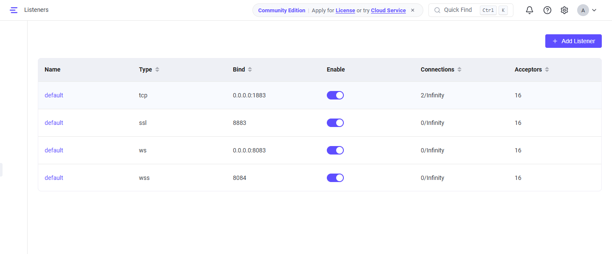
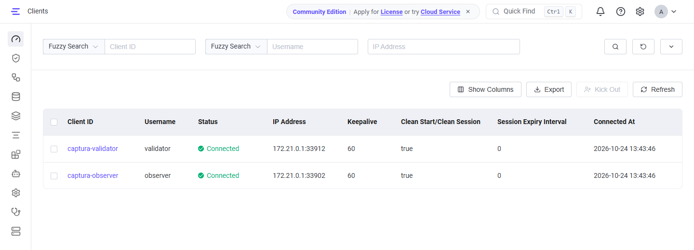
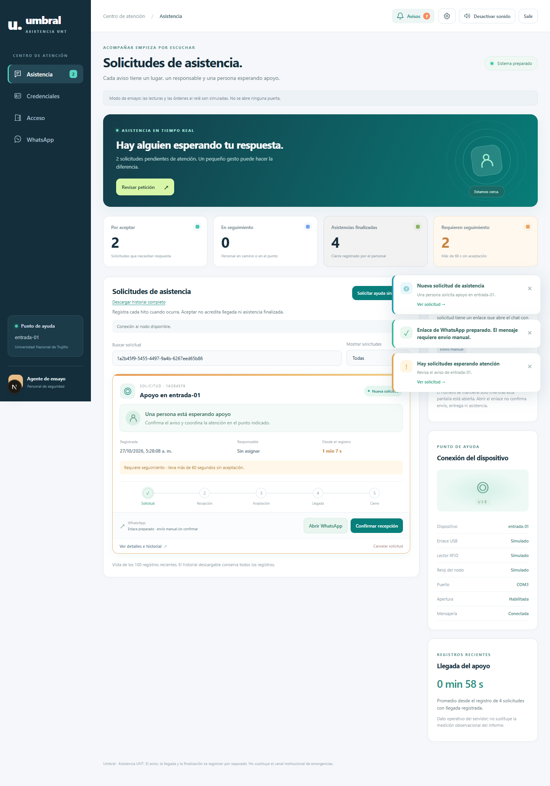

# Laboratorio 7

Comunicación MQTT, publicación/suscripción y conexión serial con Arduino

## 1. Identificación y alcance

Proyecto: Sistema IoT de control de acceso con NFC para la asistencia a personas con discapacidad. Institución académica: Universidad Nacional de Trujillo, Facultad de Ingeniería, Escuela Profesional de Ingeniería de Sistemas. Curso: Internet de las Cosas. Docente: Dr. Ing. Gómez Avila José. Fecha de elaboración: 24 de octubre de 2026.

Se presenta el desarrollo aplicado al proyecto, con código fuente, procedimientos reproducibles y evidencias de software. La validación utiliza EMQX y PostgreSQL reales, y un extremo serial simulado. No participaron personas en estos ensayos ni se conectaron lector, RTC o relés para comprobarlos. Los resultados no demuestran apertura mecánica ni asistencia efectiva a un usuario.

Se diferencia entre implementado y comprobado en software, reportado sin comprobación física, y propuesto. La ruta /laboratorios de Next.js está conectada a los servicios PostgreSQL/MQTT mediante un gateway local autenticado. La aplicación original conserva su ruta y SQLite; no se migraron sus datos. El desarrollo se limita a laboratorios 6 y 7. El laboratorio 8 queda a cargo de otro integrante y sus archivos no se modifican.

## 2. Objetivos y correspondencia con la guía

Configurar y verificar la comunicación con EMQX, diferenciar publicadores y suscriptores y conectar el protocolo serial reportado del Arduino mediante un servicio puente. La guía desarrolla Docker, Dashboard, listeners, WebSocket, archivos independientes de publicación/suscripción y el monitor del bróker (pp. 1–8); las actividades de la página 9 solicitan integrar MQTT con Arduino y documentar las configuraciones.

Los ejemplos PHP se adaptan a Node.js para aprovechar el backend del proyecto y mantener Next.js. Se incluyen publicacion.cjs y suscripcion.cjs como archivos independientes, equivalentes en función a los ejemplos de la guía. La sustitución de lenguaje debe aceptarla el docente.

## 3. Configuración y fundamentos

| Parámetro | Valor utilizado |
|---|---|
| Bróker | EMQX 6.3.2, instancia local con autenticación PostgreSQL |
| MQTT TCP | mqtt://127.0.0.1:1883 |
| MQTT sobre WebSocket | ws://127.0.0.1:8083/mqtt |
| Dashboard | http://127.0.0.1:18083 |
| Dispositivo lógico | entrada-01 |
| Puerto serial inicial | COM3 configurable; puerto físico por confirmar |
| Velocidad inicial | 9600 baudios; concordancia con firmware por confirmar |
| Modo verificado | SERIAL_SIMULATED=1 |
| Publicación | QoS 1, retain=false |

El listener WebSocket transporta MQTT para clientes compatibles. El Dashboard es una interfaz de administración HTTP distinta. Las sesiones de laboratorio son limpias; el cliente restablece las suscripciones tras reconectar. El QoS 1 puede repetir entregas, por lo que se utilizan identificadores y deduplicación. No se equipara un acuse MQTT con apertura de puerta.

La Figura 1 muestra los listeners de la instancia realmente utilizada.



## 4. Publicadores, suscriptores y mensajes

Todos los tópicos de dispositivo usan el prefijo asistencia/v1/dispositivos/entrada-01/.

| Sufijo o tópico completo | Publicador | Suscriptor |
|---|---|---|
| lecturas | Puente | Validador |
| comandos | Validador | Puente |
| resultados | Puente | Validador |
| estado | Puente | Supervisión futura; no consumido por el validador actual |
| asistencia/v1/seguridad/avisos | Validador | Observador de consola |

La confirmación de recepción del panel utiliza HTTP y PostgreSQL; no se implementó un tópico MQTT de confirmación del guardia.

La lectura serial acepta exactamente tres campos: ACCESO,UID,fecha_hora. El puente normaliza el UID y publica un JSON con schema=1, event_id UUID, device_id, uid, device_time_raw y received_at. La fecha recibida del Arduino se conserva; los permisos se evalúan con la hora del servidor.

Ejemplo de estructura ilustrativa compatible con el formato implementado, no medición experimental:

```json
{"schema":1,"event_id":"00000000-0000-4000-8000-000000000001","device_id":"entrada-01","uid":"A1B2C3D4","device_time_raw":"2026-10-24 09:00:00","received_at":"2026-10-24T14:00:00Z"}
```

La orden incluye command_id, event_id, device_id, action, relay, issued_at y expires_at. El puente solo acepta CONCEDIDO o ABRIR, relés numéricos 1 o 2 y vigencia no superior a cinco segundos. El ejemplo anterior no debe reutilizarse como lectura vigente durante una prueba posterior: las fechas y UUID deben generarse en tiempo de ejecución.

El resultado serial tiene estado simulated o serial_write_completed y physical_open=null. El aviso contiene notification_id, event_id, ubicación, tipo de solicitud y decisión. channel=mqtt_y_panel_web identifica el mensaje técnico de MQTT y el aviso web. No se equipara a SMS, WhatsApp, correo ni a asistencia humana comprobada.

## 5. Implementación y flujo completo

1. El lector y el RTC forman el nodo reportado. Para esta verificación el texto serial se introduce en un proceso simulado.
2. El puente valida tamaño, cantidad de campos y UID. Descarta lecturas si aún no puede recibir órdenes por MQTT.
3. El validador recibe la lectura, verifica dispositivo y antigüedad, y consulta la tarjeta activa y el permiso vigente para esa entrada.
4. Una transacción registra el evento y, si procede, el comando y el aviso. El identificador del evento evita crear una nueva orden por repetición.
5. El validador publica la orden. El puente comprueba formato, vigencia, retención y duplicados antes de escribir CONCEDIDO,n al serial. ABRIR,n está soportado por el parser del puente; el gateway del panel genera esa orden tras autenticar la sesión y registrar el evento.
6. En modo simulado se imprime la orden y se registra simulated. El modo real utiliza SerialPort; la recepción del comando por el firmware y la apertura física requieren ensayo posterior.
7. Si la tarjeta tiene assistance_requested=true se publica un aviso, incluso si el permiso es denegado. El personal puede necesitar apoyar a una persona sin que el sistema autorice automáticamente el ingreso.

Se implementó un búfer serial limitado con recuperación tras líneas sobredimensionadas. Las órdenes retenidas, vencidas y anteriores al arranque se descartan. El puente mantiene una exclusión de tres segundos entre órdenes para evitar sobrecargar un firmware posiblemente bloqueante; esto no certifica el pulso eléctrico de tres segundos. Un sketch con delay(3000) bloquearía el ciclo principal durante ese intervalo; sin el archivo Arduino no se afirma que ese delay exista ni se inventan pines.

## 6. Procedimiento de ejecución

Iniciar infraestructura desde la raíz del proyecto. En una instalación nueva ejecutar setup una vez; en este entorno ya existe configuración:

```powershell
npm install
npm run iot:up
```

Abrir tres terminales independientes y ejecutar un servicio en cada una:

```powershell
npm run iot:subscribe
```

```powershell
npm run iot:validator
```

```powershell
npm run iot:bridge
```

Crear un permiso de ensayo suministrando un inicio explícito. El uso del instante actual es una elección del ensayo, no una confirmación de la regla institucional:

```powershell
$inicioEnsayo = (Get-Date).ToUniversalTime().ToString('o')
npm run iot:card -- A1B2C3D4 "Persona de prueba" 2 true $inicioEnsayo
```

En la terminal del puente simulado introducir:

```text
ACCESO,A1B2C3D4,fecha_de_ensayo
```

Como alternativa al ingreso por consola, el publicador independiente genera una lectura con UUID y fecha actual de recepción:

```powershell
npm run iot:publish -- A1B2C3D4
```

El publicador usa un clientId único para no desconectar al puente. La publicación requiere al validador para producir una decisión. El monitor del Dashboard permite observar los clientes; las capturas adjuntas muestran dos clientes técnicos de demostración, no dispositivos físicos ni personas conectadas.



Para repetir la verificación completa y generar evidencias independientes:

```powershell
npm run iot:verify
```

## 6.1. Demostración completa desde Next.js

Se incorporó la ruta /laboratorios en un servidor local que supervisa puente y validador. Desde esta vista se puede iniciar sesión, registrar credenciales, elegir el inicio del permiso, simular lecturas, enviar órdenes manuales y confirmar recepción de avisos. La regla de inicio se hace explícita en cada ensayo y no se presenta como una decisión institucional definitiva.

Iniciar esta alternativa desde la raíz del repositorio; no ejecutar al mismo tiempo los workers de consola con los mismos clientId:

```powershell
npm run iot:up
npm run iot:panel:setup
npm run iot:panel
```

Abrir http://127.0.0.1:3100/laboratorios. La contraseña del panel se consulta localmente en PANEL_PASSWORD dentro de laboratorio-6/.env.local. No se incluye en la entrega. El gateway mantiene la sesión mediante cookie HttpOnly y limita las operaciones a solicitudes originadas desde su propio panel local. El frontend no recibe credenciales MQTT ni de PostgreSQL.

El registro de tarjetas usa PostgreSQL y conserva el historial por revocación de permisos previos. La lectura simulada se envía por stdin al puente real del laboratorio; recorre MQTT y el validador, y vuelve al historial mediante API/SSE. La orden manual autenticada registra un evento y publica ABRIR,n. La interfaz separa autorización de estado del envío y declara expresamente la simulación.

El mensaje al guardia está implementado como aviso web en pantalla y un sonido opcional que el usuario habilita en el navegador. La confirmación de recepción se guarda mediante HTTP y PostgreSQL, sin añadir tablas ni alterar el esquema del laboratorio 8. No acredita asistencia efectiva. Mensajería externa y audibilidad física permanecen por verificar.

La Figura 3 corresponde a la prueba real de navegador con una tarjeta de ensayo y serial simulado. La evidencia completa conserva también una captura móvil.



Para repetir el ensayo automatizado:

```powershell
npm run test:iot:panel
```

Se comprobaron sesión, protección de origen, alta de tarjeta, vigencia de tres horas, flujo MQTT visible, aviso, activación del control de sonido, vista móvil, confirmación, orden manual y revocación. La prueba agrupó estas acciones en diez comprobaciones y limpió sus propios datos temporales. El control de sonido fue activado en navegador; no se midió audibilidad con altavoces.

## 7. Resultados reales de software

| ID | Comprobación ejecutada | Resultado |
|---|---|---|
| L7-01 | MQTT sobre WebSocket en listener 8083 | APROBADO |
| L7-02 | Flujo serial simulado a MQTT, decisión y aviso | APROBADO |
| L7-03 | Registro de comando simulado para relé 2 | APROBADO |
| L7-04 | Evento duplicado no crea nueva orden | APROBADO |
| L7-05 | Publicador independiente y tarjeta desconocida sin comando | APROBADO |
| L7-06 | Comando vencido rechazado por protocolo | APROBADO |
| L7-07 | Registro del extremo serial simulado | APROBADO |
| P7-01 | API de datos exige sesión | APROBADO |
| P7-02 | Sesión y estado del puente en Next.js | APROBADO |
| P7-03 | Operaciones rechazan origen distinto al panel local | APROBADO |
| P7-04 | Formulario crea solicitud de asistencia y permiso de tres horas desde inicio explícito | APROBADO |
| P7-05 | Lectura desde la web recorre puente, MQTT y validación y vuelve al historial | APROBADO |
| P7-06 | Aviso visible y control de sonido habilitado; audibilidad física no medida | APROBADO |
| P7-07 | Vista móvil sin desbordamiento horizontal | APROBADO |
| P7-08 | Confirmación de recepción persiste sin atribuir asistencia realizada | APROBADO |
| P7-09 | Orden manual autenticada ABRIR,2 llega al puente simulado | APROBADO |
| P7-10 | Revocación desde API conserva el historial y deshabilita la credencial | APROBADO |

La prueba WebSocket publicó y recibió un mensaje de ensayo en el tópico de avisos, con dos clientes autenticados. El flujo de control utilizó otro ensayo con serial simulado, servicios reales y registros PostgreSQL. La orden para relé 2 quedó registrada como simulated y physical_open=null. La repetición del mismo evento mantuvo un único comando; una tarjeta desconocida produjo DENEGADO.

El registro JSON adjunto conserva identificadores de los ensayos y el aviso recibido. No se calculan porcentajes de lectura ni latencias de apertura porque no se dispone de mediciones físicas. El vencimiento del comando se verifica por software; no prueba la reacción del mecanismo de acceso.

## 8. Plan de validación física y accesibilidad

| Medición pendiente | Procedimiento propuesto | Registro |
|---|---|---|
| Lecturas correctas y errores | Comparar cada presentación física con UID esperado y eventos generados | Intentos, aciertos, no lecturas y duplicados |
| Lectura hasta activación | Medir inicio de lectura y activación eléctrica con reloj/instrumento común | Diferencia por intento y método |
| Pulso de cada relé | Medir inicio y fin eléctricos | Duración; no confundir con latencia |
| Avisos al guardia | Comprobar pantalla, sonido y canal acordado, más confirmación humana | Generación, recepción y asistencia por separado |
| Accesibilidad | Recorrer interfaz por teclado y lector de pantalla; revisar mensajes | Barreras observadas, sin presumir certificación |

La tabla resultados_pruebas.csv permanece vacía para estas mediciones. No se completan datos con participantes, tiempos o porcentajes inventados.

## 9. Conclusiones y límites

Se implementaron la publicación/suscripción y el puente serial–MQTT en software, con control de vigencia, deduplicación y registro en PostgreSQL. También se comprobó MQTT sobre WebSocket. El flujo de avisos conserva la asistencia como finalidad y evita deducir una discapacidad únicamente del UID.

La integración física con Arduino está preparada, pero no puede certificarse sin sketch, placa y montaje. Los pines de los relés y su polaridad siguen por confirmar. El modo real debe usar un único propietario del puerto; detener el servidor antiguo que abra ese COM antes de iniciar el puente. El panel incorpora sonido opcional y confirmación de recepción; su activación y persistencia se verificaron en navegador. El canal externo, la audibilidad física y la recepción por un guardia real no se han comprobado. La equivalencia de los ejemplos PHP con los clientes Node.js queda para aceptación docente.

## 10. Anexos de código y evidencias

- publicacion.cjs y suscripcion.cjs: clientes independientes.
- src/bridge.cjs, src/validator.cjs y src/repository.cjs: flujo implementado.
- src/protocol.cjs y src/client.cjs: contrato y conexión.
- evidencias/verificacion-software.json y resultados_software.csv: observaciones reales.
- GUIA_ORIGINAL.pdf: guía usada y correspondencia de actividades.

## Referencias

- Guía original del laboratorio, incluida en GUIA_ORIGINAL.pdf. Las páginas citadas corresponden a ese archivo.
- Informe IOT 1 Unidad.docx, proporcionado por el equipo; utilizado para conservar el contexto del proyecto.
- EMQX. Instalación con Docker: https://docs.emqx.com/en/emqx/latest/get-started/deploy/install-docker.html
- EMQX. Configuración y precedencia: https://docs.emqx.com/en/emqx/latest/guides/configuration/configuration.html
- EMQX. Autenticación PostgreSQL: https://docs.emqx.com/en/emqx/latest/guides/access-control/authn/postgresql.html
- EMQX. Autorización PostgreSQL: https://docs.emqx.com/en/emqx/latest/guides/access-control/authz/postgresql.html

La referencia a documentación actual sustenta la configuración utilizada; no se afirma que 6.3.2 sea la última versión disponible. La versión ejecutada se verifica en los registros y el Dashboard.

