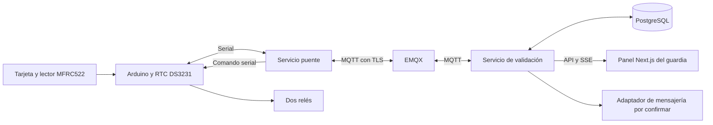

# Laboratorio 7 — Publicación, suscripción y puente con Arduino

> Este desarrollo recoge la revisión previa. Para el código implementado y las comprobaciones posteriores, consultar [IMPLEMENTACION.md](../IMPLEMENTACION.md) y [VERIFICACION_IMPLEMENTACION.md](../VERIFICACION_IMPLEMENTACION.md).

## Alcance y estado de la entrega

Desarrollo documental aplicado al “Sistema IoT de control de acceso con NFC para la asistencia a personas con discapacidad”. No se ejecutaron instalaciones ni pruebas de hardware para esta entrega. Se distingue la implementación visible en código de las propuestas y de los requisitos sin evidencia. Se conserva Next.js y PostgreSQL como objetivo; esta copia del servidor utiliza Node.js/Express y SQLite. El sketch Arduino sigue sin localizarse.

## Objetivo y requisitos de la guía

Comprobar Docker y los contenedores; acceder al Dashboard de EMQX, ajustar listeners, conectar un cliente WebSocket, publicar y suscribir mensajes. Los ejemplos separan publicacion.php y suscritor.php. Las actividades finales requieren integrar MQTT con Arduino y documentar la configuración.

## Desarrollo aplicado al proyecto

1. Comprobar servicio Docker y contenedores con docker ps; conservar salida real.
2. Registrar versión/edición de EMQX y configuración efectiva del Dashboard y listeners. Las credenciales históricas de la guía no se asumen vigentes.
3. Probar publicación y suscripción con dos clientes independientes, conservando identificadores y mensajes recibidos.
4. Consultar si el docente acepta Node.js como equivalente de los ejemplos PHP. Mantener Next.js para la interfaz del guardia.
5. Incorporar un único propietario del puerto serial: el puente. Trasladar o desactivar la lectura serial del servidor actual para evitar acciones duplicadas.
6. Ensayar lectura, validación, orden y aviso; diferenciar envío serial de apertura física y recepción de aviso de asistencia realizada.

## 4. Arquitectura y flujo de operación

### Arquitectura observable

El Arduino se comunica por puerto serial con un servidor Node.js/Express que también atiende la aplicación Next.js. El servidor consulta SQLite, responde al dispositivo, registra el resultado y publica eventos SSE para actualizar el panel. Esta descripción corresponde al repositorio; PostgreSQL forma parte de la arquitectura objetivo.

### Arquitectura objetivo propuesta



1. El lector obtiene el UID. La obtención de fecha y hora desde el DS3231 está reportada; su implementación y sincronización requieren revisar el sketch.
2. Arduino emite una línea `ACCESO,UID,fecha_hora`. En la propuesta, el puente valida formato y longitud, normaliza el UID, conserva la fecha original y agrega identificador del evento y hora de recepción.
3. El servicio de validación consulta la tarjeta, su estado, el permiso asociado al acceso y su vigencia. La necesidad de asistencia se consulta como atributo independiente del permiso. En el código actual únicamente se comprueban UID, estado activo y expiración.
4. Si corresponde autorizar, se genera una orden dirigida al relé 1 o 2. El puente la convierte en `CONCEDIDO,n`; una apertura manual autorizada utiliza `ABRIR,n`. La reacción del firmware a `DENEGADO` está por confirmar.
5. Arduino activa el relé correspondiente durante los 3 segundos reportados. Enviar el comando no demuestra activación eléctrica, apertura mecánica ni tránsito de la persona. Cada una requiere evidencia diferente.
6. Se registra lectura, decisión, motivo, permiso utilizado y estado del envío. Se propone persistir la decisión y la orden pendiente en una transacción antes de enviarla, para permitir trazabilidad. El código actual escribe al serial antes de insertar el registro y carece de confirmación física.
7. Si la persona solicita asistencia, se genera un aviso al guardia con ubicación y acción requerida. La propuesta mantiene el aviso incluso ante una denegación cuando se requiera apoyo, sin abrir automáticamente un acceso no autorizado. El personal confirma recepción y asistencia por separado.

El panel deberá mostrar texto claro y señales visuales; el sonido será complementario. Se propone verificar navegación por teclado, contraste, compatibilidad con lector de pantalla y un procedimiento de asistencia manual ante fallas. No se afirma cumplimiento de una norma de accesibilidad sin evaluación.

## 5. Integración propuesta con MQTT y EMQX

### Verificación de versión

La consulta a las notas oficiales el 20 de octubre de 2026 identificó **EMQX Enterprise 6.3.2**, publicado el 16 de octubre de 2026. Esto verifica una versión publicada, no la instalada en el proyecto. Versión, edición, modalidad de despliegue y licencia disponibles: **por confirmar**. Antes de configurar, registrar la versión mostrada por la instancia y revisar su documentación específica. No se entregan archivos antiguos de plugins ni una configuración ejecutable cuya compatibilidad no pueda verificarse.

Fuente: [Notas oficiales de EMQX Enterprise 6](https://docs.emqx.com/en/emqx/latest/release-notes/changes-ee-v6.html).

La documentación actual describe integración PostgreSQL para autenticación y autorización; deben verificarse disponibilidad y opciones en la edición seleccionada. No basta con sustituir el nombre MySQL en una configuración previa. Fuentes: [Autenticación PostgreSQL](https://docs.emqx.com/en/emqx/latest/guides/access-control/authn/postgresql.html) y [Autorización PostgreSQL](https://docs.emqx.com/en/emqx/latest/guides/access-control/authz/postgresql.html).

### Roles y tópicos propuestos

El puente será el único proceso propietario del puerto serial. El manejador serial actual deberá trasladarse o desactivarse para evitar dos procesos leyendo el mismo puerto o dos decisiones de apertura. El servicio de validación puede reutilizar el backend Node.js/Express observado; su uso definitivo en despliegue está por confirmar.

| Tópico | Publicador | Suscriptor | Finalidad |
|---|---|---|---|
| `asistencia/v1/dispositivos/entrada-01/lecturas` | Puente | Servicio de validación | UID y fecha de lectura |
| `asistencia/v1/dispositivos/entrada-01/comandos` | Servicio de validación | Puente de entrada-01 | Orden de apertura autorizada |
| `asistencia/v1/dispositivos/entrada-01/resultados` | Puente | Servicio de validación | Estado del envío serial, sin atribuir apertura física |
| `asistencia/v1/dispositivos/entrada-01/estado` | Puente | Servicio de supervisión | Conectividad del puente y serial |
| `asistencia/v1/seguridad/avisos` | Servicio de validación | Servicio de notificación | Solicitud de asistencia |
| `asistencia/v1/seguridad/confirmaciones` | Servicio de notificación | Servicio de validación | Recepción confirmada por guardia, cuando exista |

El panel recibe eventos mediante API/SSE del backend; no necesita credenciales del bróker. Si se exige un cliente web MQTT, su implementación y alcance se consultarán con el docente.

Ejemplos ilustrativos; identificadores y tiempos no constituyen resultados de pruebas:

```json
{"schema":1,"event_id":"evt-ejemplo-001","device_id":"entrada-01","uid":"A1B2C3D4","device_time_raw":"2026-10-20 09:00:00","received_at":"2026-10-20T14:00:00Z"}
```

```json
{"command_id":"cmd-ejemplo-001","event_id":"evt-ejemplo-001","action":"CONCEDIDO","relay":1,"issued_at":"2026-10-20T14:00:00Z","expires_at":"2026-10-20T14:00:05Z"}
```

```json
{"command_id":"cmd-ejemplo-001","status":"serial_write_completed","physical_open":null}
```

```json
{"notification_id":"aviso-ejemplo-001","event_id":"evt-ejemplo-001","location":"entrada-01","type":"asistencia_solicitada","message":"Se requiere apoyo en el ingreso","channel":"por_confirmar"}
```

El vencimiento de cinco segundos del ejemplo es una propuesta de vigencia del comando, distinta de la duración del relé y del permiso personal; deberá ajustarse y verificarse mediante pruebas.

Se propone QoS 1 con deduplicación por identificador, comandos sin retención y descarte de órdenes vencidas. Tras una reconexión no deben ejecutarse aperturas atrasadas. Las retransmisiones no deben producir nuevas aperturas. La deduplicación en el puente reduce duplicados MQTT, pero el protocolo serial actual no transporta identificadores ni confirmaciones: no garantiza ejecución exactamente una vez ante un reinicio. Una confirmación del firmware y un identificador serial serían extensiones propuestas, no funciones actuales. La indisponibilidad del servicio debe impedir nuevas aperturas automáticas y activar asistencia manual; no se enviarán comandos de apertura acumulados al recuperar conexión.

### Tres controles independientes

- **Acceso físico:** determina si una persona puede usar un acceso durante un intervalo y qué relé corresponde.
- **Autenticación MQTT:** identifica al puente o servicio que establece conexión; no autentica a la persona portadora de la tarjeta.
- **Autorización MQTT:** limita qué tópicos puede publicar o suscribir cada cliente. El puente solo publica lecturas/resultados/estado de su dispositivo y se suscribe a sus comandos; el validador tiene permisos inversos y publica avisos. El notificador no publica comandos de apertura.

Se propone TLS con validación del certificado, credenciales independientes por servicio y denegación de operaciones no autorizadas. Las credenciales del guardia para administrar el panel constituyen otro control de aplicación; la API local disponible no muestra autenticación. No exponerla como panel remoto de producción sin implementar ese control. El UID identifica una tarjeta; no debe describirse como prueba criptográfica de identidad ni de discapacidad.

## 7. Revisión Arduino: alcance y acciones pendientes

No se dispone del sketch, por lo que no es posible identificar nombres de constantes ni números de pines sin definir, verificar compilación o asegurar que exista `delay(3000)`. Estos puntos quedan como revisión pendiente, no como defectos demostrados.

| Punto | Revisión necesaria |
|---|---|
| Pines de los dos relés | Identificar las declaraciones ausentes o incompletas en el sketch. No asignar números hasta conocer placa y cableado; revisar compatibilidad con conexiones SPI del lector e I2C del RTC |
| Polaridad y arranque | Confirmar nivel activo y asegurar ambos relés inactivos al iniciar; no asumir relé activo en HIGH o LOW |
| Comandos | Aceptar exclusivamente `CONCEDIDO,1`, `CONCEDIDO,2`, `ABRIR,1` y `ABRIR,2`, con terminador definido; rechazar campos extra, relé fuera de rango y líneas incompletas |
| Conversión numérica | Evitar una conversión permisiva que acepte `1basura` como 1; comprobar token completo y cantidad de campos |
| Recepción serial | Limitar longitud del búfer, manejar CR/LF, fragmentación y tiempo máximo de línea sin bloquear indefinidamente |
| Denegación | Definir manejo de `DENEGADO` sin activación y sin confundirlo con un comando de apertura |
| Bloqueos | Si existe `delay(3000)`, durante ese intervalo el flujo principal no procesa nuevas lecturas ni comandos; las interrupciones pueden seguir recibiendo bytes y el búfer podría desbordarse |
| Temporización propuesta | Usar máquina de estados y `millis()` por relé; definir qué ocurre con órdenes simultáneas o repetidas y comparar tiempos mediante resta sin signo |

La activación de tres segundos no informa cuánto tarda el sistema desde leer la tarjeta hasta comenzar la apertura. Eliminar `delay()` es una propuesta de mejora condicionada a revisar el firmware real.

## 10. Plan de pruebas y resultados pendientes

Antes de ensayar, registrar versión de firmware, placa, pines verificados, versión del servidor y bróker, esquema de base, topología, sincronización de relojes y regla de inicio del permiso. Definir previamente cantidad de intentos y umbrales de aceptación con el docente; ambos están por confirmar. Utilizar identificadores de prueba sin diagnósticos ni datos personales innecesarios.

| Prueba | Procedimiento | Medida |
|---|---|---|
| Lectura correcta | Presentar tarjetas con UID conocido, registrando cada presentación independientemente del sistema; variar orientación y distancia documentadas | Lecturas con UID correcto / presentaciones; registrar no lecturas, UID incorrectos y duplicados por separado |
| Validación y errores | Probar tarjeta activa, desconocida, revocada, vencida, UID mal formado y relé inválido | Comparar decisión esperada y obtenida; falsos permisos y falsas denegaciones por separado |
| Latencia de apertura | Capturar instante de UID disponible y comienzo de activación del relé con instrumentación común; medir apertura mecánica por separado si existe sensor | Diferencia por intento, luego mediana, percentil 95 y máximo; método y resolución documentados |
| Pulso del relé | Medir inicio y fin eléctricos de cada relé con instrumento apropiado | Duración real del pulso frente a 3 s nominales y tolerancia por acordar |
| Aviso visual y sonoro | Provocar solicitud de asistencia y observar pantalla; comprobar sonido solo cuando exista implementación | Avisos generados, mostrados y audibles por separado; tiempos desde lectura y desde generación |
| Mensajería | Elegir canal, provocar aviso y registrar identificador del proveedor; comprobar recepción en el destino | Aceptación del proveedor, entrega y confirmación del guardia como estados diferentes |
| Permiso temporal | Con inicio definido, comprobar antes, exactamente en y después del vencimiento de 3 horas; incluir revocación y renovación | Resultado esperado/obtenido y marcas temporales del servidor; a la igualdad se propone denegar |
| Fallas y reconexión | Desconectar serial, red, bróker y base; reinyectar mensajes duplicados y comandos vencidos | Órdenes indebidas, pérdidas, duplicados y recuperación; ninguna apertura por comando vencido |
| Asistencia y accesibilidad | Recorrer panel con teclado y lector de pantalla; simular recepción y confirmación del guardia | Barreras observadas y trazabilidad de asistencia; evaluación con personas usuarias, si se realiza, requiere planificación y participantes por confirmar |

La disponibilidad del UID es el inicio técnico definido para la medición; si se mide desde la presentación física, se informará como otra métrica. Un RTC con resolución de segundos no basta para estimar latencias pequeñas. No restar relojes de equipos distintos sin controlar desfase. El retorno de escritura serial y el acuse MQTT no son mediciones de apertura. Para percentiles, informar número de observaciones y método de cálculo.

La prueba de tres horas debe ejecutarse con duración real; las pruebas con reloj controlado son complementarias y se reportan como simuladas. El criterio propuesto para notificaciones es comparar recibidas en destino con generadas, conservando fallas y reintentos; entrega no demuestra asistencia efectiva.

### Tabla vacía de resultados reales

| ID | Caso / condición | Versión / configuración | Intentos | Lecturas correctas | No lecturas / errores / duplicados | Decisión esperada / obtenida | t lectura | t inicio relé | Latencia ms | Pulso ms | Canal | t entrega | Confirmación guardia | Inicio / vencimiento permiso | Evidencia / observaciones |
|---|---|---|---|---|---|---|---|---|---|---|---|---|---|---|---|
| | | | | | | | | | | | | | | | |
| | | | | | | | | | | | | | | | |
| | | | | | | | | | | | | | | | |

No existen resultados cuantitativos incorporados. La ejecución de pruebas y la evaluación del sistema completo permanecen pendientes.

## Casos de demostración específicos

| Caso | Acción propuesta | Resultado esperado, no medido |
|---|---|---|
| Publicación/suscripción | Publicar lectura de ejemplo en el tópico del dispositivo | El suscriptor obtiene el mismo event_id |
| Arduino autorizado | Presentar tarjeta con permiso vigente | Decisión trazable y comando dirigido al relé correcto |
| Arduino denegado | Presentar tarjeta desconocida o vencida | Registro sin orden de apertura |
| Asistencia | Usar perfil de prueba que solicita apoyo | Aviso al guardia; canal y entrega por verificar |
| Duplicado | Reenviar un evento/comando con el mismo identificador | No producir nueva apertura por duplicación |
| Reconexión | Restablecer MQTT con comando vencido | Descartar apertura atrasada |

## Estado y evidencias pendientes

MQTT, WebSocket y el puente están propuestos, no implementados en el código revisado. Falta evidencia de Docker, Dashboard, listeners, publicador y suscriptor, monitor EMQX y Arduino. Los tres segundos son duración nominal del relé; la latencia deberá medirse. Completar resultados_pruebas.csv únicamente con observaciones reales.

