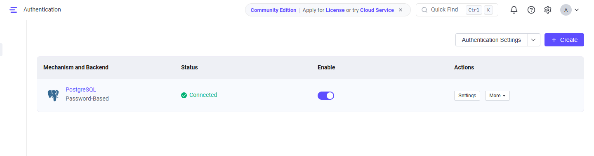
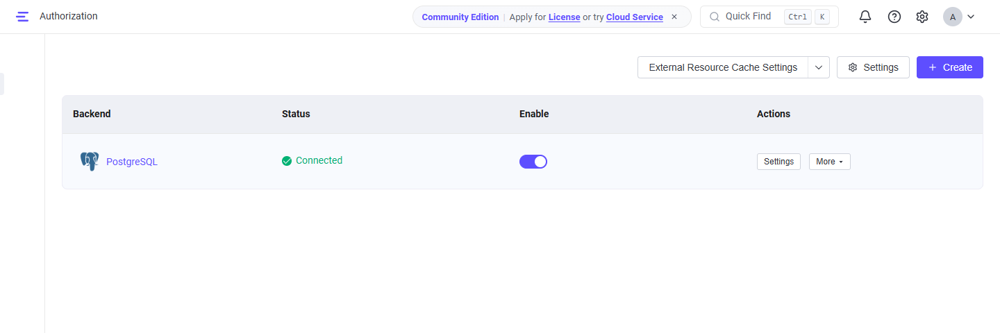

# Laboratorio 8

Autenticación y autorización MQTT con PostgreSQL

## 1. Identificación y alcance

Proyecto: Sistema IoT de control de acceso con NFC para la asistencia a personas con discapacidad. Institución académica: Universidad Nacional de Trujillo, Facultad de Ingeniería, Escuela Profesional de Ingeniería de Sistemas. Curso: Internet de las Cosas. Docente: Dr. Ing. Gómez Avila José. Fecha de elaboración: 24 de octubre de 2026.

Se presenta el desarrollo aplicado al proyecto, con código fuente, procedimientos reproducibles y evidencias de software. La validación utiliza EMQX y PostgreSQL reales, y un extremo serial simulado. No participaron personas en estos ensayos ni se conectaron lector, RTC o relés para comprobarlos. Los resultados no demuestran apertura mecánica ni asistencia efectiva a un usuario.

Se diferencia entre implementado y comprobado en software, reportado sin comprobación física, y propuesto. Next.js se conserva en la aplicación original; su backend actual usa SQLite. Los servicios de laboratorio utilizan PostgreSQL de forma separada. No se presenta esa separación como una migración del panel ya concluida.

## 2. Objetivos y adaptación de la guía

Configurar el control de clientes MQTT usando una base de datos, autenticar credenciales y autorizar exclusivamente publicaciones y suscripciones permitidas. Se conserva PostgreSQL como motor del proyecto y se demuestra el resultado con EMQX 6.3.2.

La guía parte de Windows virtualizado y MySQL/phpMyAdmin, abre administración remota, crea las tablas mqtt_user y mqtt_acl y configura un plugin MySQL (pp. 1–9). Su página 4 remite expresamente a documentación EMQX 4.3. Las páginas 9–13 modifican publicador/suscriptor y comprueban entrega. No se copia ese plugin en la versión actual: se usa el autenticador y el autorizador PostgreSQL verificados en la instancia.

| Secuencia de la guía | Adaptación aplicada | Situación |
|---|---|---|
| Windows virtualizado y servicios previos | Windows anfitrión y contenedores Linux | Funcional; equivalencia formal por consultar |
| phpMyAdmin y acceso a MySQL | psql/pg y acceso restringido a PostgreSQL | No se instala phpMyAdmin |
| Base laboratorio | Base asistencia, esquemas separados | Nombre adaptado al proyecto |
| mqtt_user y mqtt_acl | Tablas del esquema mqtt_security | Implementadas |
| Plugin MySQL EMQX 4.3 | Backend PostgreSQL actual | Implementado y conectado |
| Publicador/suscriptor | Roles bridge, validator y observer | Aceptación y denegación probadas |

## 3. Separación de responsabilidades

El permiso físico corresponde a una tarjeta, dispositivo, relé e intervalo. La autenticación MQTT determina qué servicio se conecta al bróker. La autorización MQTT determina qué tópicos puede usar ese servicio. La cuenta administrativa del Dashboard es una cuarta identidad, distinta del operador del panel y de las tarjetas.

| Identidad | Control | Ejemplo |
|---|---|---|
| Tarjeta de una persona | Estado y permiso de ingreso | UID activo y permiso vigente |
| Cliente MQTT | Usuario y contraseña del servicio | Puente de entrada-01 |
| Operación MQTT | Regla de publicación/suscripción | El puente recibe comandos, no los publica |
| Administrador Dashboard | Gestión del bróker | Cuenta admin con contraseña local generada |

Las tablas de acceso no se reutilizan para autenticar clientes MQTT. Un aviso de apoyo tampoco concede automáticamente acceso. El esquema registra solicitud de asistencia, sin diagnósticos médicos.

## 4. Esquema y roles implementados

| Tabla | Campos y restricciones relevantes |
|---|---|
| mqtt_security.mqtt_user | username PK, password_hash, salt, active, is_superuser restringido a false |
| mqtt_security.mqtt_acl | username FK, permission, action, topic; PK compuesta |

| Rol PostgreSQL | Privilegios |
|---|---|
| iot_owner | Inicialización y administración del laboratorio; limpieza aislada de ensayos |
| iot_app | Uso de access_control y SELECT/INSERT/UPDATE; sin DELETE |
| mqtt_reader | Uso y SELECT de mqtt_security; sin acceso de escritura ni permisos de aplicación |

setup.cjs genera credenciales aleatorias distintas. Para el ejercicio se almacena SHA-256 de contraseña más salt, con salt en posición suffix, coherente con el autenticador configurado. No se publican contraseñas, salts ni hashes reales en los informes. La configuración utiliza credenciales de alta entropía generadas localmente; no se presenta como política definitiva de producción.

## 5. Configuración de autenticación

La conexión desde EMQX se realiza a postgres:5432 dentro de la red Docker, base asistencia, usuario mqtt_reader. No se usa localhost dentro del contenedor para referirse al otro servicio. Las consultas son plantillas del bróker; la variable se resuelve mediante su mecanismo de parámetros.

```sql
SELECT password_hash, salt, is_superuser
FROM mqtt_security.mqtt_user
WHERE username = ${username} AND active = true
LIMIT 1;
```

En base.hocon se configura mechanism=password_based, backend=postgresql y password_hash_algorithm con name=sha256 y salt_position=suffix. El archivo real con la contraseña de conexión se genera localmente y se omite del paquete. El Dashboard muestra el autenticador PostgreSQL habilitado y conectado (Figura 1).



## 6. Configuración de autorización

El autorizador consulta reglas de mqtt_acl; no_match=deny impide operaciones sin coincidencia y deny_action=disconnect desconecta por operación denegada. La caché de autorización está deshabilitada para este laboratorio. La lista de fuentes configurada contiene PostgreSQL, sin una fuente adicional que permita todas las operaciones.

```sql
SELECT permission, action, topic
FROM mqtt_security.mqtt_acl
WHERE username = ${username}
ORDER BY permission ASC;
```

| Cliente MQTT | Publicación autorizada | Suscripción autorizada |
|---|---|---|
| bridge-entrada-01 | lecturas, resultados y estado de entrada-01 | comandos de entrada-01 |
| validator | comandos de entrada-01 y seguridad/avisos | lecturas y resultados de entrada-01 |
| observer | Ninguna | seguridad/avisos |

Los sufijos de dispositivo corresponden al prefijo asistencia/v1/dispositivos/entrada-01/. El tópico de avisos es asistencia/v1/seguridad/avisos. El puente no puede publicar órdenes de apertura y el observador no puede suplantar al validador. La Figura 2 muestra la fuente de autorización de la instancia.



## 7. Procedimiento reproducible

En una instalación nueva generar configuración y levantar contenedores; en el equipo actual setup ya fue ejecutado y no debe sobrescribir credenciales:

```powershell
npm install
npm run iot:setup
npm run iot:up
```

schema.sql crea tablas y restricciones; bootstrap.generated.sql crea roles, usuarios MQTT y reglas. Ambos se aplican únicamente en el primer inicio con volumen vacío. Una modificación posterior requiere migración controlada; reiniciar el contenedor no vuelve a inicializar una base existente.

Comprobar sin imprimir secretos:

```powershell
docker exec asistencia-iot-labs-postgres-1 psql -U iot_owner -d asistencia -c "SELECT username,active,is_superuser FROM mqtt_security.mqtt_user;"
docker exec asistencia-iot-labs-emqx-1 /opt/emqx/bin/emqx ctl status
npm run iot:verify
```

El script de verificación abre clientes válidos e inválidos y consulta reglas y roles. Sus evidencias no incluyen passwords, hashes ni salts. Al finalizar, los procesos temporales y los registros de ese ensayo se retiran; el entorno persistente permanece.

## 8. Adaptación de sintaxis MySQL y controles de red

| Elemento de la guía MySQL | Equivalente PostgreSQL utilizado |
|---|---|
| AUTO_INCREMENT | GENERATED ALWAYS AS IDENTITY |
| DATETIME | TIMESTAMPTZ para vigencias |
| TINYINT(1) | BOOLEAN |
| Marcadores de parámetros del controlador | $1, $2 en las consultas pg de la aplicación |
| DATE_ADD e intervalos MySQL | Expresión + interval '3 hours' |
| Cliente phpMyAdmin | psql o controlador pg; pgAdmin como opción futura |
| Plugin EMQX 4.3 | Autenticador/autorizador PostgreSQL de EMQX 6.3.2 |

No se transfiere literalmente Require all granted ni bind-address=0.0.0.0 de la guía a una administración expuesta. Los puertos publicados se limitan a 127.0.0.1; PostgreSQL y EMQX se comunican por la red interna del laboratorio. Una extensión a otras máquinas requiere reglas específicas de red y TLS. No se afirma haber realizado el acceso remoto ni la VM Windows de la guía.

El docente debe confirmar la equivalencia PostgreSQL/MySQL, la herramienta de administración, la versión de EMQX, los clientes Node.js frente a PHP y el entorno de virtualización. Esa aceptación no se presupone.

## 9. Resultados reales

| ID | Comprobación ejecutada | Resultado |
|---|---|---|
| L8-01 | Roles PostgreSQL separados | APROBADO |
| L8-02 | Usuarios y reglas sin exponer credenciales | APROBADO |
| L8-03 | Autenticación válida de observador | APROBADO |
| L8-04 | Contraseña MQTT incorrecta | APROBADO |
| L8-05 | Observador no publica comandos | APROBADO |
| L8-06 | Puente no publica comandos | APROBADO |
| L8-07 | Puente no se suscribe a otro dispositivo | APROBADO |
| L8-08 | Límite temporal semiabierto y duración de 3 horas | APROBADO |
| L8-09 | Restricción SQL rechaza duración distinta de 3 horas | APROBADO |

Se comprobó conexión válida, rechazo de contraseña incorrecta, impedimento de publicación indebida tanto del observador como del puente, y rechazo de suscripción del puente a otra entrada. Las consultas confirman separación de roles y reglas sin privilegios MQTT de superusuario.

La prueba temporal utilizó fechas controladas y el repositorio real: al vencer el permiso se obtuvo DENEGADO sin comando; la solicitud de asistencia permaneció independiente. La restricción SQL rechazó un permiso temporal de dos horas. La consulta de frontera comprobó que el instante inicial pertenece al intervalo y el final no. No se esperaron tres horas reales ni se verificó el reloj del Arduino.

## 10. Conclusiones y evidencias pendientes

La autenticación y autorización MQTT mediante PostgreSQL quedaron implementadas y verificadas, separadas del control de acceso físico. El modelo evita otorgar permisos por el solo hecho de conectarse al bróker y limita a cada servicio a sus tópicos.

La actividad se desarrolla como una adaptación funcional, no como una reproducción literal del plugin MySQL antiguo. Permanecen pendientes la aceptación docente de equivalencias, el ensayo físico de Arduino, el criterio institucional de inicio de vigencia, la espera real de tres horas y la entrega al personal de seguridad por el canal acordado. No se atribuye a estas pruebas ninguna certificación de seguridad o accesibilidad.

## 11. Anexos

- schema.sql: DDL público del esquema; los secretos se generan con setup.cjs.
- create-card.cjs: registro de credencial y permiso con inicio explícito; historial conservado por revocación.
- evidencias/verificacion-software.json: roles, ACL y resultados sin secretos.
- resultados_software.csv: resultados de esta ejecución.
- resultados_pruebas.csv: plantilla para observaciones adicionales reales.

## Referencias

- Guía original del laboratorio, incluida en GUIA_ORIGINAL.pdf. Las páginas citadas corresponden a ese archivo.
- Informe IOT 1 Unidad.docx, proporcionado por el equipo; utilizado para conservar el contexto del proyecto.
- EMQX. Instalación con Docker: https://docs.emqx.com/en/emqx/latest/get-started/deploy/install-docker.html
- EMQX. Configuración y precedencia: https://docs.emqx.com/en/emqx/latest/guides/configuration/configuration.html
- EMQX. Autenticación PostgreSQL: https://docs.emqx.com/en/emqx/latest/guides/access-control/authn/postgresql.html
- EMQX. Autorización PostgreSQL: https://docs.emqx.com/en/emqx/latest/guides/access-control/authz/postgresql.html

La referencia a documentación actual sustenta la configuración utilizada; no se afirma que 6.3.2 sea la última versión disponible. La versión ejecutada se verifica en los registros y el Dashboard.

